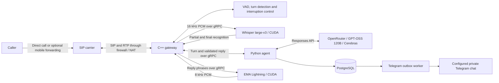

# Alojan

A Turkish-first phone assistant with self-hosted SIP/RTP, speech recognition and
speech synthesis, an external conversation model, and post-call Telegram notifications.

**Status: working development deployment, not a production release.**
This page describes the implementation and recorded validation as of **2026-10-27**.
An open-source license has not yet been adopted; see [License](#license).

Alojan combines *alo* (the Turkish telephone greeting) and *ajan* (agent).
The current implementation supports authenticated workspaces, configurable agents,
one active agent per verified number, a Next.js management UI and a token-protected
HTTP MCP server. Agents use scoped tools and configured post-call Telegram/HTTP
actions. Calls retain transcripts, summaries and delivery outcomes. The qualified
live deployment currently serves one verified inbound number; simultaneous-call
capacity is a separate acceptance gate. It does not depend on a hosted voice orchestration platform.

See the [platform design](docs/VOICE_AGENT_PLATFORM.md),
[MCP client setup](docs/MANAGEMENT_MCP_CLIENTS.md) and
[current validation record](docs/PLAN.md) for the latest scoped capabilities.
MCP endpoints and credentials are supplied privately, never as repository defaults.

## What works today

| Area | Implemented behavior |
|---|---|
| Inbound telephony | Native C++20/PJSIP SIP and G.711 RTP gateway; a real Netgsm trunk has been exercised. The carrier profile waits three seconds before answering and plays a prepared AI introduction. |
| Speech recognition | Persistent faster-whisper **standard large-v3** on CUDA FP16, beam five, with pinned model files and checksum verification. |
| Speech synthesis | Persistent **EMA Lightning** CUDA worker streams Turkish speech in bounded audio chunks. |
| Conversation control | Silero VAD, Smart Turn v3.2, turn deadlines, interruption handling, silence reminders and timeout closing. |
| Dialogue | OpenAI Agents SDK with OpenRouter **`openai/gpt-oss-120b`**, medium reasoning and Cerebras-only routing without provider fallback. |
| Message intake | Tool-mediated local note storage, corrections and additions, clarification of unclear input, a once-per-call further-help invitation and contextual closing. Messages are not read back for confirmation. |
| Playback and cancellation | Bounded queues, per-call generation invalidation, stale-audio rejection and sent-audio accounting. The gateway waits for closing audio and a configured closing pause before hanging up. |
| Call records | PostgreSQL stores call metadata, available caller identity, recognized dialogue, notes and structured post-call summaries. |
| Notifications | A separate Telegram worker sends the caller number when available, stored call times, summary and available final dialogue after the call ends. Long conversations use numbered messages with persisted delivery progress. |
| Diagnostics | gRPC health checks, structured service events, stage latency reporting, native integration tests and optional model evaluation tools. |

Caller ID is a carrier-supplied hint, not authentication. Missing or withheld numbers
remain unknown. Assistant text in records is based on sent-audio accounting; it is
not proof that every word was heard at the handset. Caller text is ASR output and
may contain recognition errors.

The agent can save a request for the owner. It cannot verify the owner's calendar,
transfer a call to a person, answer from a verified company knowledge base or promise
that a callback will happen. Saving a note and delivering a Telegram message are
separate operations.

## Architecture

The Linux Docker Compose profile runs the gateway, ASR, TTS, agent, API, PostgreSQL
and Telegram worker. ASR/TTS use the host NVIDIA GPU through its container runtime;
SIP and loopback gRPC retain the host network layout. Speech inference is local;
conversation and summary requests use OpenRouter. Telegram requires Internet access.
See [Docker setup and recovery](docs/DOCKER.md) for deployment and validation limits.

### How a call flows

1. The gateway accepts an allowed inbound SIP call, waits for the configured answer
   delay and plays the prepared greeting after call establishment.
2. Incoming audio is decoded and resampled for recognition. VAD and turn detection
   decide when to finalize the caller's turn.
3. The agent receives the final text and bounded conversation history. Validated
   tools select speech, save a local note or request a polite closing.
4. The gateway sends reply phrases to EMA and plays its audio over RTP. Quiet waiting
   music can cover response preparation; it is excluded from conversation records.
5. Caller interruption invalidates the old generation and clears queued output.
   Cancellation does not instantly preempt an already running GPU kernel.
6. After the final farewell and closing pause, the call ends. Summary work and
   Telegram delivery proceed separately from the live audio path.

**Streaming has specific boundaries.** Whisper partials are repeated decoding of
buffered audio, not native incremental token streaming. The agent streams provider
responses, but waits for complete, validated speech-tool arguments before emitting
reply phrases. EMA then streams audio. This is not an end-to-end speech-to-speech model.

## Validation and current limits

Real inbound calls, understandable synthesized speech, interruption and successful
hangup have received limited handset acceptance. The standard large-v3 switch also
received a successful live-call report. These checks establish a working development
path, not broad production, noise-robustness or latency guarantees.

| Evidence | Recorded result and scope |
|---|---|
| [Docker runtime and recovery](docs/validation/docker-runtime-2026-10-24.md) | Seven services run in Compose; container regression and process-recovery evidence, soak status and limits are recorded separately. |
| [Consolidated Linux validation](docs/validation/main-publication-2026-10-24.md) | Native build and all nine CTests passed. The full Python run had 385 passes, one contract-test failure and 18 skips; after correcting that test, the affected 76-test subset passed. The complete suite was not repeated. |
| [Standard large-v3 activation](docs/validation/whisper-large-v3-live-2026-10-24.md) | 45 ASR tests passed; seven real CUDA gRPC cases and lifecycle checks passed before and after activation. One successful live call was subsequently reported. |
| [Real carrier conversation](docs/validation/carrier-m3m4-2026-10-24.md) | Call records, interruption/accounting and successful closing were inspected; the report retains recognition and timing limitations. |
| [Telegram validation](docs/validation/telegram-2026-10-24.md) | The expanded notification/database suite passed 33 tests. HTTP tests use simulated delivery; live activation and later content-validation limits are recorded separately. |

Known limits and unfinished work:

- **Concurrency:** speech workers currently admit one stream each; raising a gateway
  setting alone does not provide parallel AI calls. Five calls per host and fifty
  across hosts are approved design targets, not implemented or validated capacity.
  See [the capacity plan](docs/CALL_CAPACITY_PLAN.md).
- **Latency and quality:** stage measurements exist, but percentile response-time,
  noisy-speech, false-interruption and long-running reliability targets remain open.
  Some synthetic dialogue checks still fail; see the linked validation reports.
- **Recognition alternatives:** Nemotron is selectable for evaluation. Other ASR and
  denoising comparisons are optional tools; no RNNoise/DTLN preprocessing stage is
  enabled in the default live pipeline. Standard large-v3 trades additional decode
  time for improved accuracy on the evaluated small corpus.
- **Lifecycle:** Compose restart policies and local worker watchdogs recover process
  failures. The single-installation profile reconciles missing end records after the
  hard call-duration limit. In-memory call/generation reclamation beyond the existing
  lifetime bounds still needs work; a worker restart does not resume an active call.
- **Notification delivery:** retries and per-part receipts are durable, but Telegram
  does not provide an exactly-once guarantee. A failure after remote acceptance and
  before receipt persistence can duplicate a part. Summary failure produces an
  explicitly unavailable summary with the available dialogue.
- **Management:** API health and database foundations exist; a full call dashboard,
  contact management, operator retry interface and end-to-end OpenTelemetry setup
  are not completed features.
- **External tools:** an approval-gated MCP boundary exists, but arbitrary external
  MCP tools are not attached to the phone agent. Calendar writes, live transfer,
  voice cloning and multi-tenant bot/account management are not implemented.
- **iPhone forwarding:** the carrier and iOS control forwarding. The repository does
  not provide a verified, unattended Focus-mode forwarding installation.
- **Release engineering:** hosted CI and clang-tidy validation remain pending.

## Development setup

Use [DOCKER.md](docs/DOCKER.md) for the complete Linux deployment and recovery.
Use [DEV_SETUP.md](docs/DEV_SETUP.md) for pinned build tools, migrations and checks.
Its early foundation profiles remain useful transport tests; starting the default
WAV gateway alone does **not** launch the complete assistant.

The working hardware reference is Ubuntu with an RTX 4080-class GPU and 16 GB VRAM.
This is a tested development configuration, not a minimum specification or a
concurrent-call capacity claim. macOS can be used for editing and selected checks;
real CUDA speech validation takes place on Linux.

Set up the components in this order:

1. Build the service images using the Docker guide; the gateway compiles inside Docker.
2. Configure private database credentials, start PostgreSQL with
   [`infra/compose.yaml`](infra/compose.yaml), and apply migrations.
3. Prepare the pinned model caches for [ASR](services/asr/README.md) and
   [TTS](services/tts/README.md); mount them into their containers.
4. Configure an OpenRouter key privately for the [agent](services/agent/README.md).
5. Configure the [gateway profile](services/voice-gateway/README.md) and your
   [carrier network](docs/NETWORK_NETGSM.md). Keep evaluation listeners on loopback
   and restrict carrier-facing SIP/RTP at the firewall.
6. Optionally create your own bot and pair a private chat using
   [Telegram setup](docs/TELEGRAM.md). Each installation supplies its own token and
   recipient; the worker is single-owner, not a shared multi-tenant bot platform.
7. Start the Compose runtime and verify all container health checks before carrier testing.

There is no one-command production installer. Adapt the assistant identity, owner
references and prepared greeting assets before using the project for another person;
the current implementation is not a profile-management product. Keep credentials,
recipient identifiers and installation-specific values in ignored private files.

## Repository map

| Path | Purpose |
|---|---|
| `services/voice-gateway/` | Native SIP/RTP, media queues and conversation control |
| `services/asr/` | Default Whisper service and pinned model manifests |
| `services/asr-nemotron/` | Separate environment for the optional ASR backend |
| `services/tts/` | Persistent EMA speech worker |
| `services/agent/` | Dialogue, local note tools, summaries and Telegram worker |
| `services/app-api/` | API health and database/migration foundation |
| `services/voice-contracts/`, `proto/`, `generated/` | Shared validation and versioned gRPC contracts |
| `infra/` | Full-runtime Compose overlay, Docker builds/watchdogs, database migrations and legacy service template |
| `assets/` | Prepared prompts and waiting audio |
| `tests/`, `tools/` | Regression suites, integration probes and optional evaluations |
| `docs/` | Requirements, decisions, task status and sanitized acceptance evidence |

## Privacy and security

Raw caller audio recording is off by default. Text transcripts and notes are stored
in PostgreSQL; enabling Telegram sends available final dialogue and call metadata
to the configured private chat. Conversation/summary requests send relevant text
to the configured model provider. Self-hosted audio processing is not fully offline
processing or a promise that no data leaves the server.

Never commit credentials, real caller numbers, private transcripts, recordings or
packet captures. Use synthetic fixtures for shared tests. Caller text and model/tool
outputs are untrusted; caller ID does not authorize private access or external actions.
See [the security policy](SECURITY.md) and [security design](docs/SECURITY.md).

## Roadmap and contributing

The [task plan](docs/PLAN.md) tracks M0–M6 and the remaining acceptance gates.
Near-term work includes measured response latency, broader dialogue/recognition
quality, lifecycle hardening and capacity implementation. Planned work is not a
claim that those capabilities are available today.

Read [CONTRIBUTING.md](CONTRIBUTING.md), [CODE_OF_CONDUCT.md](CODE_OF_CONDUCT.md),
[requirements](docs/REQUIREMENTS.md) and the [acceptance plan](docs/CALL_TEST_PLAN.md)
before changing behavior. Keep native, simulated, GPU, provider and carrier evidence
separate when reporting results.

## License

No project license has been adopted. [GPL-3.0-or-later is proposed](docs/LICENSING.md),
pending approval and dependency/distribution review. Do not assume unrestricted
reuse rights until a license is added. Model and dependency licenses must also be
reviewed; the [dependency inventory](docs/DEPENDENCIES.md) records their sources and pins.
