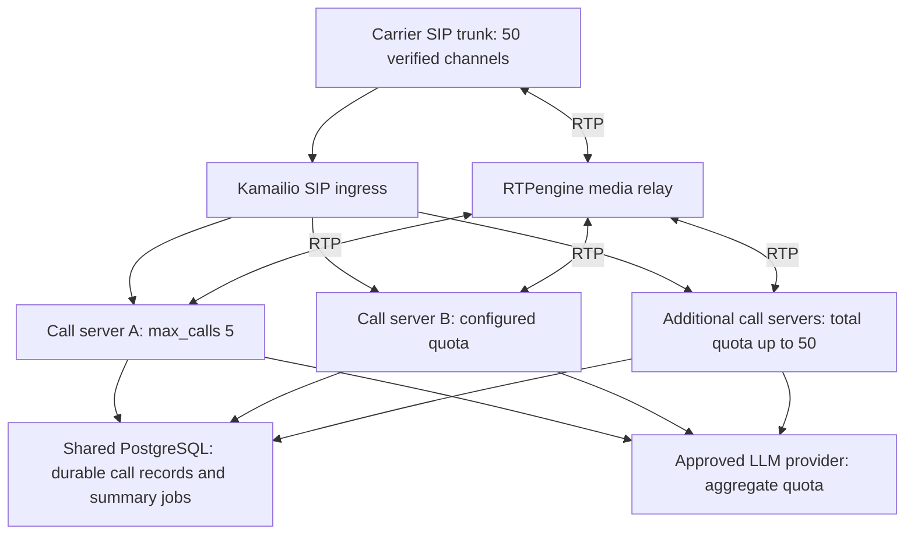

# Configurable call capacity: five per host, fifty across the deployment

Date: 2026-10-24. Method: Ponytail full.
Status: owner-selected capacity target; researched architecture and implementation
plan only. No new capacity has been implemented, deployed or measured.
Supersedes the earlier two-call proposal and C2-01–08 task list.

## Scope and operating contract

Design for 50 simultaneous independent AI telephone conversations across multiple
servers. Each server has its own configurable hard limit. The current Linux RTX
4080 host's intended profile is `max_calls = 5`. Additional calls receive SIP 486
Busy Here when no eligible server has space. There is no waiting-call queue.
One owner/assistant number remains the product scope; multiple destination numbers,
multi-tenancy and live human transfer are not added.

A configured slot is not proof of hardware capacity. Validate five complete
ASR/LLM/TTS conversations on the existing host and 50 on the provisioned deployment.
Do not claim 50-call readiness from 50 SIP/WAV sessions or from multiplying five
by ten. [ADR 0009](ADR/0009-call-capacity.md) records the owner's changed target;
implementation and live rollout are subsequent work.

## Recommended architecture



Each call server contains the existing C++ gateway/session engine plus local
ASR, EMA TTS and agent services. Speech models remain resident once per configured
worker, not once per call. Scale by adding complete call servers with measured
capacities. This avoids making the original GPU a shared bottleneck for 50 calls
and preserves current local gRPC boundaries. A dedicated shared GPU inference pool
is not needed for the first deployment; introduce one only if measurements justify
its network, routing and scheduling complexity.

Use Kamailio as the SIP entry point and RTPengine for the multi-server media path
behind a stable carrier-facing address. Keep existing PJSIP media and conversation
control. First prove the local five-call path, then prove ingress plus two nodes,
then provision enough qualified nodes for 50. The one-host development profile may
retain direct SIP/RTP until ingress validation; it must enforce the same local cap.

## Capacity configuration and enforcement

Proposed configuration, not a runnable current command:

```toml
# Deployment inventory, owned and versioned by the operator.
[deployment]
max_calls = 50

[[servers]]
id = "linux-gpu-01"
max_calls = 5
```

Other servers can use different positive limits up to the deployment target.
`max_calls = 0` means drain/no new calls, not unlimited. Invalid, negative or
conflicting configuration fails startup/reload. Existing installations default to
one until explicitly configured. Preserve the old test flag as a deprecated alias
with its original 1–2 range; reject conflicting flags instead of silently overriding.
All services expose configured capacity and effective readiness in sanitized health
output; calls are admitted only when the complete local pipeline is ready.

Use one admission owner/gateway process per host. It atomically reserves a slot
before ringing/answering, counting ringing and established calls. SIP retransmits
reuse the existing transaction reservation. Release exactly once on rejected setup,
CANCEL, BYE, failure or timeout. Keep separate tracking for inference work that is
still draining so a released phone slot does not overcommit GPU resources.
PJSUA endpoint limits and compile-time ceilings must also be audited; the CLI cap
cannot exceed what the endpoint and media configuration can actually support.

In the cluster, Kamailio chooses an eligible destination using call-load dispatch
and its per-destination cap. Local admission remains authoritative against stale
routing counts or races. Route a capacity rejection to another eligible node only
before call establishment and after the previous attempt has definitively ended;
never fork a caller into two AI sessions. Bound attempts by eligible destinations
and an overall setup deadline. No destination with capacity means 486 to the carrier.
Dependency failures retain a distinct internal reason and controlled failure policy;
capacity rejection is never hidden by answering and leaving the caller silent.

The first implementation uses **static quota partitioning**: the sum of assigned
node limits must be at most 50. Generate node configuration and dispatcher caps
from the same validated inventory. This gives a global bound without Redis or a
custom distributed semaphore. A full node may reject while other nodes have slots;
the ingress tries those nodes. With only the current five-slot host deployed, the
sixth concurrent call is busy. With 50 qualified slots deployed, the 51st is busy.

On quota reduction, grandfather existing calls but admit no new ones above the new
limit. Do not transfer freed quota to another host until the old host's occupancy
falls within its reduced allocation. Unreachable nodes retain their allocation
until fenced/drained: disappearance is not proof their calls ended. Replace nodes
using a new boot identity and fenced old process. Multiple gateways on one host
must explicitly partition that host's quota; multiplying processes must not
multiply allowed calls. Config revisions, duplicate IDs and drift are checked.

## SIP, media and availability

Keep a call pinned to its selected node for its entire lifetime. Preserve SIP
Record-Route/dialog routing for ACK, re-INVITE, CANCEL and BYE. Do not move active
media or conversation state when adding/removing nodes. Globally unique internal
call IDs include node/boot uniqueness; caller number never identifies a session.
Keep original caller identity provenance across the trusted proxy; only allow
trusted ingress peers to supply identity headers. The node's existing carrier
source allowlist must be adapted deliberately rather than disabled.

Use one active SIP ingress initially; a fenced standby is part of production
hardening. Reconcile established dialogs before standby admission, failing closed
on uncertain state. Do not claim transparent active-call recovery after gateway,
relay or ingress failure. A failed call server can lose its calls; healthy servers
continue and new traffic avoids it. RTPengine and PostgreSQL are explicit shared
failure domains. Document tested backup/recovery and interruption behavior before
calling the deployment highly available. Static node caps still bound admissions
even when proxy load counters are stale after restart.

Allocate disjoint, documented RTP/RTCP ports and correct advertised SDP/NAT addresses
per host and relay. Do not copy the current 10000–10100 range blindly: a basic
non-mux gateway needs at least two local ports per audio call; a relay with two
non-mux legs needs at least four, plus teardown/reuse headroom. Validate the actual
pinned implementation's allocator and RTCP use. Carrier and private-node firewall
rules remain explicit; media relay control and gRPC must not be public. Use private
network isolation and authenticated/encrypted transport when crossing hosts.
Cloudflare remains HTTP management only; raw recording remains off.

## Inference and state changes

### ASR

Current `RecognitionService` admits one stream and owns global active/inference
state. Replace that with bounded call-local stream contexts and a measured worker
budget, independent from the call cap. Start with fair scheduled native decoding,
then compare the pinned faster-whisper `num_workers` capability if needed. One
outstanding decode per call, bounded waiting work, obsolete-partial coalescing and
final-result priority must avoid starvation. Preserve fresh endpoint evidence;
coalescing cannot silently turn an old partial into a final decision.

Native decode cannot be preempted: retain its resource reservation until completion
and discard stale output. Include monitor-to-turn overlap and long utterances in
capacity accounting. Benchmark 1, 2, 3 and 5 active callers with ASR and TTS sharing
the GPU. File transcription batching is not automatically live cross-call batching.
Do not change model, beam, precision or recognition behavior merely to pass load.

### TTS

Current `SynthesisService` admits one request; the local EMA adapter has shared
request/stop state and warms with batch size one. Replace global request state with
per-request ownership, bounded output queues and targeted cancellation. Prefer
EMA's existing Playhead scheduler to a second custom scheduler or a model per call.
Audit the pinned 1.1.2 code and local private-API outbox adapter before enabling
concurrent entry; upstream documentation alone does not establish adapter safety.

Warm and validate measured batch sizes with ASR resident. Bound text/phrase size,
pending requests and PCM per call. A slow consumer must not block Playhead for
other callers: cancel/evict its request within its existing write budget and prove
other streams progress. If the pinned scheduler blocks on a full bounded outbox,
fix that integration before rollout. Test ordering, per-request resampler state,
identical seeds and cancellation inside a shared batch. No global cancellation.

### Agent, tools and storage

Replace the hard-coded two-active-turn agent ceiling with a validated local
budget consistent with `max_calls`; preserve one active turn per call. Audit
provider SDK state, VAD/Smart Turn state, conversation, note versions, playback
receipts and recovery flags for isolation. Control aggregate provider concurrency,
requests/tokens per minute and summary traffic across all nodes; node limits alone
do not guarantee the external account's quota. Keep summaries lower-priority and
bounded so 50 simultaneous closings cannot starve live responses.

Shared PostgreSQL needs bounded per-node connection pools and globally unique IDs.
Before multiple summary workers run, make job claiming atomic with lease/retry and
idempotent result writes; inspect current store semantics rather than assuming
its pending-job query is safe. Keep note idempotency scoped to call/version. Node
crash reconciliation marks abandoned calls without inventing transcripts or
replaying writes. Notifications/API work remains independently deferred.

Replace fixed 128-call/4096-generation lifetime exhaustion with safe bounded
retirement. Preserve stale-generation rejection through boot/session namespaces,
explicit closed-state checks and a documented retention horizon covering RPC
lifetimes and late receipts. Test wrap/reuse, replay and crash paths. Add compatible
protobuf lifecycle fields/RPCs only if needed and document mixed-version rollout.

## Infrastructure sizing and provisioning gates

Let C_i be the measured supported capacity of node i with the approved models,
latency targets and operational headroom. Provision sum(C_i) >= 50 and assign
sum(max_calls_i) <= 50 with max_calls_i <= C_i. Hardware inventory must include GPU
and VRAM, CPU cores/turn-detector cost, RAM, NIC, disk, model pins and measured load.

| Example | Meaning |
|---|---|
| 1 host × configured 5 | Initial requested Linux profile; five-call GPU acceptance still required |
| 10 qualified hosts × 5 | Illustrative 50-slot deployment, not a purchase recommendation or measured result |
| Mixed 5/10/etc. quotas totaling 50 | Valid if each host passes its own full-pipeline capacity test |
| Spare qualified host | Optional recovery headroom; transfer quota only after draining/fencing, not by overallocating beyond 50 |

Select actual server count after CAP-02 benchmarks; report a concrete bill of
materials and monthly/provider cost estimate before provisioning. If the current
RTX 4080 fails five-call targets, document the bottleneck and required additional
hardware or approved inference change. Do not relabel a three-call pass as five.

Network calculation (planning arithmetic): G.711 at 20 ms carries 160 bytes plus
40 bytes IPv4/UDP/RTP overhead, about 80 kbit/s per direction per call. Fifty calls
are about 4 Mbit/s each direction on one leg, before Ethernet/VPN/RTCP/headroom.
An anchored relay forwards both legs, roughly 8 Mbit/s receive and 8 Mbit/s transmit
in aggregate under those assumptions. Measure packets/second, jitter and actual
wire rates; bandwidth alone is not capacity. Reserve ample NIC/port headroom.

Verify at least 50 carrier channels and the required call-attempt rate with the
actual trunk account. Mobile forwarding may impose a different bound. Estimate
LLM load from measured turns/minute × calls × model/tool steps plus summaries;
check token limits, concurrency, 429 behavior and cost using the real account.
Warm models before making a node eligible; readiness must cover inference and DB,
not merely SIP OPTIONS. Do not autoscale cold GPUs into answered calls.

## Implementation sequence and acceptance

| ID / milestone | Deliverable | Depends on | Requirements |
|---|---|---|---|
| CAP-01 / M0 | Record owner-selected target in ADR/requirements; finalize inventory/config contract and pin/license-review new infrastructure before installation | This plan | DEC-02; §12,18 |
| CAP-02 / M2,M5 | Isolated Linux 1/2/3/5-call ASR+EMA+agent benchmarks; identify unsafe state and output a per-node capacity/resource report | CAP-01 | §3,8,15 |
| CAP-03 / M1 | Atomic host admission, capacity config, endpoint ceiling, ringing reservations, idempotent release, overload/drain tests | CAP-01 | US-01; §6,12 |
| CAP-04 / M2–M4 | ASR scheduling, EMA request isolation, configurable agent budget and CPU detector audit | CAP-02,03 | US-02/04/05/06/08; §7–10 |
| CAP-05 / M4,M5 | Lifetime cleanup, atomic summary claiming, DB pools, global IDs and failure reconciliation | CAP-04 | US-07/08; §10–12 |
| CAP-06 / M1,M5 | Pinned Kamailio/RTPengine lab, two independent nodes, inventory-derived caps, affinity, retry, NAT and health/drain | CAP-03–05 | US-01/03/05; §6,12 |
| CAP-07 / M5 | Qualify existing host at five calls, including six-call rejection and churn; produce 50-call hardware/provider sizing | CAP-04–06 | §3,15 |
| CAP-08 / M1,M5,M6 | Provision qualified nodes, test 10/25/50 full calls, 51st rejection, overload bursts, node loss and carrier concurrency | CAP-07; infrastructure/carrier access | US-01–08; §3,13,15 |
| CAP-09 / M5 | Controlled deployment, rollback/drain, ingress recovery, backups, monitoring and operator runbook | CAP-08 | §12,14–16 |

Affected surfaces: gateway `main.cpp`, speech/agent bridges, interruption and turn
detectors; ASR service/model; TTS service/model/outbox; agent service/backend/store;
shared generation control; launch scripts; deployment inventory and new ingress
configuration; service READMEs, DEV_SETUP, NETWORK_NETGSM, DEPENDENCIES, PLAN and
CALL_TEST_PLAN. Inspect graph callers/tests before implementation. Reuse existing
SIP fixtures, agent validation and latency tools; add SIPp for large signaling load
only if existing peers cannot generate it reliably. No Kubernetes, Redis, Kafka,
Triton migration or replacement voice-agent framework is required by this design.

Acceptance must include:

- Local caps 0/1/2/5 and heterogeneous cluster caps; invalid config; simultaneous
  INVITE races; retransmit/CANCEL/re-INVITE; third/sixth/51st rejection as applicable;
  stale proxy counts, quota reduction, node restart and conflicting configuration.
- Full overlapping speech and response generation, not only idle connections.
  Distinct synthetic identities/messages; same generation label on different calls;
  zero cross-call audio, text, notes, receipts or cancellation effects.
- Barge-in, slow readers, long speech, queued cancel, lost BYE, DB/provider errors,
  GPU saturation and worker outage. No unbounded queue, OOM, deadlock, leaked slot
  or unexpected resource-exhausted failure for an admitted normal call.
- Per-call and pooled P50/P95 endpoint-to-first-RTP with at least 50 eligible turns
  per concurrent call at five and 50 capacity. Preserve §3 targets (P50 <1000 ms,
  P95 <1800 ms, valid barge-in <250 ms), recording all failures and excluded turns.
  Include single-call baseline, queue time, token/phrase time, underflows and VRAM.
  A failed target stays open; waiting music is not response audio.
- At least 30 minutes continuously occupied at each target tier; a separate churn
  test exceeding the old 128-call/4096-generation boundaries. Follow with a two-hour
  full-load soak before 50-call production acceptance. Report memory plateau and
  shared DB/provider/relay bottlenecks separately from GPU performance.
- Real carrier concurrency at five and 50; direct and mobile-forwarded behavior
  separately. SIPp/fake models prove signaling/contracts only; 50-node mocks or a
  five-call result do not establish 50 real AI conversations.

Use the authorized Linux environment under ADR 0003. Preserve remote work and
live calls; run isolated tests in an idle GPU window rather than duplicating live
model instances on the same device. Hardware procurement, new server access,
provider plan changes and publication are not performed by this planning task.

## Rollout and rollback

Keep the current live profile unchanged while implementing. Qualify at 1, 2, 3,
then 5 on the existing host; deploy a controlled five-call config after acceptance.
Validate multi-node routing before scaling to 10, 25 and 50. Roll back by stopping
new admission and draining active calls before reverting binaries/configuration.
Never replay an established conversation on another node. Preserve durable notes
and jobs. On node failure accept reduced capacity until qualified capacity replaces
it. Availability and uninterrupted active-call failover are separate claims.

## Research basis (primary sources, reviewed 2026-10-24)

| Source | Finding and use |
|---|---|
| [Kamailio dispatcher](https://www.kamailio.org/docs/modules/stable/modules/dispatcher) | Call-load selection, destination `maxload`, and load updates exist. Reuse them for routing; retain local atomic admission as the hard bound. |
| [Kamailio example configuration](https://github.com/kamailio/kamailio/blob/master/src/modules/dispatcher/doc/dispatcher.cfg) | Upstream routing/failure handling example. Its round-robin defaults are not our capacity policy; adapt and test rather than copy into production. |
| [RTPengine](https://github.com/sipwise/rtpengine) | Linux media proxy with SDP/NAT support; suitable reference for a stable carrier-facing media path. |
| [RTPengine configuration](https://github.com/sipwise/rtpengine/blob/master/docs/rtpengine.md) | Session caps, drain and load controls supplement admission; size media resources separately from GPU capacity. |
| [EMA Lightning](https://github.com/canberk7/ema-lightning) | Upstream documents shared-model Playhead batching and concurrent callers. Reuse that mechanism after auditing our pinned adapter; upstream benchmarks are not RTX 4080 acceptance. |
| [EMA 1.1.2 provenance](https://pypi.org/project/ema-lightning/1.1.2/) | Check the pinned wheel/source before changes; latest repository behavior is not assumed identical. |
| [faster-whisper v1.2.1 source](https://raw.githubusercontent.com/SYSTRAN/faster-whisper/v1.2.1/faster_whisper/transcribe.py) | Inspect native worker support and request-local state; do not confuse file batching with live stream scheduling. |
| [CTranslate2 parallelism](https://opennmt.net/CTranslate2/parallel.html) | Native parallel workers/CUDA streams are available, but throughput improvement is workload-dependent. Benchmark alongside TTS. |
| [NVIDIA Triton batching](https://docs.nvidia.com/deeplearning/triton-inference-server/user-guide/docs/user_guide/batcher.html) | Stateless dynamic batching and stateful sequence scheduling differ. Useful design constraint; no Triton adoption planned. |
| [SIPp](https://github.com/SIPp/sipp) | Candidate signaling-load generator, not proof of AI or speech quality. |

These sources support the mechanisms; the topology, quota policy and sizing gates
are project design judgments. Pin exact versions/digests, review licenses and record
notices when dependencies are introduced; no research link means license approval.
No runtime test, model invocation, carrier call or remote deployment occurred in
this planning update.
