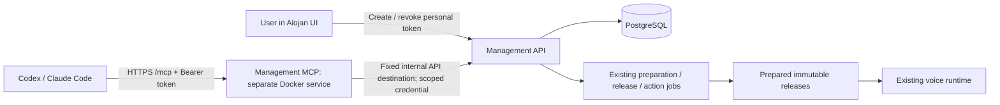

# Management MCP implementation plan

Date: 2026-10-27. Status: publicly deployed; final voice/load and conversational activation acceptance pending.
Required clients: Codex and Claude Code, as clarified by the owner.
Claude web/Desktop remote connectors and inbound OAuth are outside this release.
Public hostname approved: `<DEPLOYMENT_HOST>` through Cloudflare Tunnel on Linux.
See [implementation evidence and remaining gates](validation/management-mcp-2026-10-27.md).
Decision: [ADR 0012](ADR/0012-management-mcp.md).
Mapping: AGP-06/07/09 extension, M4–M5, requirements §11.2, US-07/08.

## Outcome and current integration points

A logged-in user creates a personal token and connects an HTTP MCP client. Through
conversation they create/configure an agent, prepare its audio, publish it, activate
it on their verified number and query calls, summaries, transcripts and deliveries.

Current reusable boundaries:

- `services/app-api/alojan/api.py`: scoped UI routes, cookie authentication,
  origin/CSRF checks and bounded request processing.
- `auth.Accounts.workspace`: current membership/role checks and scoped database
  transactions. It now accepts both browser sessions and scoped personal-token credentials.
- Profiles, Releases, Numbers, connection/grant services, VoiceJobs and Deliveries:
  existing business rules. Publication already validates prepared draft versions,
  qualified model/assets and grants; number activation additionally requires readiness.
- `Calls.list`: currently agent-filtered cursor pagination. Date, caller-number,
  status and content search are now implemented in the shared API.
- Calls/transcript: immutable route ownership and finalized/sent-utterance visibility
  remain the source of truth. Summaries can be pending or failed and must not be invented.
- Existing outbound MCP support lets voice agents use other servers. This proposal
  adds an inbound management server; the two have separate credentials and policies.

## Architecture

Use Python and a pinned, compatible official MCP SDK in `services/management-mcp`.
Select SDK/protocol versions during the compatibility spike; test protocol
negotiation explicitly rather than adopting a moving draft. Prefer stateless tool
handling and structured JSON results. Preserve required HTTP/SSE behavior of the
negotiated version. Authenticate each request; protocol session IDs are not identity.
Validate supplied Origin headers, trusted hosts, media types and request limits.

Only the MCP HTTPS route is exposed through the approved HTTP ingress. Management
API calls use a fixed internal destination with redirects disabled. Alojan-issued
tokens are validated by their own management authority; never forward them to
third-party MCP/provider services. No database credentials in the MCP container.

## Tokens and authorization

Add an account page with token name, workspace, permission presets, expiry,
creation/last-use time, copy-once secret and revoke/replace controls. Default expiry
proposal: 90 days; a shorter expiry is selectable. Offer read-only, agent editor
and publish/manage presets with an explicit permission preview. Full call transcripts
and external-action authorization are visible separate permissions.

Tokens contain a public lookup identifier and at least 256 random secret bits.
Store only a cryptographic verifier, never recoverable plaintext. Bind every token
to its creator, one workspace and this management audience. Token scope can only
narrow the user's current rights. Check enabled account, current membership/role,
expiry and revocation at every operation; no long-lived authorization cache.
New requests fail after revocation commits. Already accepted durable operations
retain explicit lifecycle semantics; revocation is not a promise to undo a sent action.

Proposed scopes: `agents:read/write`, `connections:read/write`, `calls:read`,
`transcripts:read`, `releases:publish`, `numbers:manage`, `grants:manage`,
`deliveries:retry`. Catalog/status reads map to relevant read rights. Discovery and
voice preparation require write rights and existing resource limits. Maintain a
complete operation-to-scope table; unclassified operations fail closed.

The API resolves cookie sessions and personal tokens to a common internal identity
and retains transaction-local workspace checks. Cookie routes keep CSRF/origin
rules; bearer routes do not accept browser cookies as an alternative. Never trust
user/workspace IDs supplied by the model as identity. Backend authorization must
hold even when a caller bypasses tool discovery and invokes the API directly.

Token issuance/revocation uses recent authenticated browser access and CSRF
protection. MCP cannot mint broader tokens, change account passwords or grant itself
permissions. Audit user, token ID, workspace, operation, target, result and correlation
ID without recording secrets or complete transcripts. Rate-limit by token and account
as well as enforcing process-wide limits. Last-used writes may be coalesced.

## Operational parity and tools

Build an explicit UI action → API operation → MCP tool → scope → test matrix before
implementation. The following families define coverage; tool names are illustrative.
Use specific typed tools, not arbitrary HTTP/SQL execution or an unrestricted command
dispatcher. Filter discovery by permissions, but enforce permissions at invocation too.

| Family | Required coverage |
|---|---|
| Context/catalog | Current workspace/permissions, agent schema, models, supported catalog tools, readiness and performance |
| Agents | List/get/create/update, owner/assistant names, instructions, vocabulary, approved model, tool config, outputs and post-call actions; optimistic versions |
| Connections | List/create/revoke provider, Telegram, HTTP and outbound MCP connections; discovery status, approved tool schemas, OAuth start/completion handoff |
| Grants | Review exact MCP/action configuration, authorize/revoke bounded grants, list current grants |
| Voice | Preview configuration, request/status of audio preparation, authorized audio preview link/resource without leaking asset paths |
| Releases | Prepare/validate, list history, publish, readiness/status, rollback |
| Numbers | List/register, show verification state, activate/rebind/deactivate; never self-certify ownership |
| Calls | Filter/search calls, details, summary status/content, paged transcript, declared outputs and action results |
| Deliveries | List/details, retry review and bounded retry under existing delivery semantics |

Account bootstrap/login/password/token creation and platform-operator controls are
explicit exceptions to operational parity. New connection secrets use a short-lived,
user/workspace-bound authenticated credential-entry page initiated by MCP; the model
receives a connection reference/status only. OAuth needs the provider's interactive
consent when required. Existing connections can be reused entirely through MCP.
Credentials must not be pasted into chat or included in tool output/logs.

## Conversational create-to-live workflow

1. Read accessible workspace, current agents/numbers, schemas and connections.
2. Create a draft with an operation key; update instructions/model/tools/outputs with
   explicit versions. Return validation errors and missing prerequisites precisely.
3. Review proposed external actions and MCP grants. A token with explicit
   `grants:manage` may authorize the exact reviewed configuration as delegated by its
   owner; otherwise return a scoped approval handoff. Changing the configuration
   invalidates its review. Tool text or `confirmed=true` never establishes authority.
4. Queue voice preparation using the existing admission controls. Return job ID and
   retry interval; clients query status instead of holding an HTTP request indefinitely.
5. Prepare and publish the exact validated revision using `releases:publish`.
6. Wait for node readiness, then activate on the verified number using
   `numbers:manage`. Replacing an existing agent is an explicit versioned rebind.
7. Read authoritative routing/readiness and report the actual state. A published
   release alone does not mean calls can reach it. If binding fails, report partial
   completion and preserve the current binding; do not silently unpublish or replace.

Number registration is not number verification. A call already in progress remains
pinned to its release. At most one agent answers a number. Work can resume after an
MCP client disconnect using persisted jobs/releases/operation status.

## Querying calls and summaries

Extend the shared Calls API with bounded date/time range, agent, called number,
caller number where stored, call status, summary status and text query filters.
Validate time zones/date bounds, normalize numbers and use stable opaque cursors
bound to workspace and filters. Return call IDs, timestamps and matched source.
Use details/paged transcripts for grounding; search-list excerpts remain deferred. Summary text and transcript searches are distinguishable;
transcript search requires transcript permission. Keep incomplete/failed summaries
explicit. No raw audio recording is enabled by this feature.

Start with parameterized PostgreSQL search and appropriate measured indexes; no
vector database or semantic-search service. Cap page size, text length, date range,
query time and total response bytes. Turkish search behavior needs fixtures. Filter
by authorized immutable call ownership before selecting or returning any matches.
Do not dump all conversations into the client's context. Treat retrieved utterances
and remote tool descriptions as untrusted data, not operational instructions.

## Persistence and retry safety

Add additive migrations after the current latest migration (currently 0026):

- `personal_access_tokens`: creator/workspace, verifier/public prefix, scopes,
  management audience, expiry/revocation and last-used metadata with foreign keys.
- `management_operations`: user/workspace, tool/action, idempotency key, canonical
  request digest, state and safe result/reference; unique operation identity and
  seven-day result replay. Compact up to 100 expired payloads per successful write;
  retain key/digest tombstones so old retries never execute again. Recheck
  authorization before replaying a stored result.
- Reuse existing audit and job tables. Add query indexes only after examining query
  plans; keep SQL fixtures synthetic and compatible with PostgreSQL.

Creation, publication/binding, grant issuance and retry enqueueing accept a stable
operation key. Concurrent identical retries return one result; a reused key with a
different payload conflicts. Commit the operation identity and business mutation in
the same transaction, or reference the existing durable job transaction. JSON-RPC
request IDs alone are not idempotency keys. No automatic retry of ambiguous writes
without this boundary. Provider delivery guarantees remain adapter-specific.

## Performance and deployment

MCP has separate CPU/memory, connection, request and concurrency budgets. Share no
voice worker/event loop. Bound its downstream API concurrency so it cannot consume
all browser-management capacity (currently a small shared limiter); reserve browser
capacity or apply admission before expensive work. Cap DB pool/query duration and
coalesce last-used metadata. All expensive audio work uses the existing queue and
GPU preparation window; MCP cannot request a direct competing inference job.

Test baseline versus MCP read/search/write load on the same host with matched call
scenarios and existing performance gates. No guaranteed latency claim before this
measurement. MCP outage must not interrupt calls. Rollback disables MCP ingress and
stops its service; use a compatible API/web rollback image with additive schema kept.
Existing accepted publications are not implicitly reverted.

Cloud clients require a stable publicly reachable HTTPS address. Select DNS/TLS and
the DEC-14 Cloudflare Tunnel route at deployment; interactive ingress login must not
intercept machine bearer requests. Application authentication still protects every
MCP operation. The owner approved `<DEPLOYMENT_HOST>` via Cloudflare Tunnel. Deployment remains
pending Linux access; no public exposure has been performed.

## Work packages and acceptance

| ID | Deliverable | Acceptance |
|---|---|---|
| MCP-01 | Ratify ADR, action/scope matrix, SDK/client spike | Codex and Claude Code initialize/list/invoke through authenticated Streamable HTTP; versions recorded |
| MCP-02 | Token persistence/API/UI and common authorization | Two-user isolation, expiry/revoke/role downgrade, no secret logging, cookie CSRF regression; denied direct-API bypass |
| MCP-03 | Separate MCP app, catalog/read tools, call search | Typed errors/results, pagination and permission-filtered search, time/size limits, client installation guides |
| MCP-04 | All configuration and connection/grant tools | Full parity matrix, secure credential/OAuth handoff, concurrent UI/MCP version conflicts, durable idempotent writes |
| MCP-05 | Audio/release/number workflow and deliveries | Resumable preparation-to-activation, stale review rejection, explicit rebind, one active agent per number, bounded retry |
| MCP-06 | Linux integration, performance and rollout | Browser regressions, real client journey, revocation, fault/retry/load checks, rollback and isolated service deployment |

Each package includes source/contract review, meaningful negative tests and a recorded
result before the next package. No package is complete on mocked success alone.
Client-specific network acceptance, live-call acceptance and performance evidence
are recorded separately. A fresh real integration/notification test requires its own
authorized destination; prior one-off message permission is not reused.

Minimum end-to-end acceptance: owner creates a limited token, connects a real client,
creates/configures an agent, prepares assets, publishes and activates a verified
available test number, retrieves that call's summary/transcript, then revokes the
token and observes further access rejected. A second user cannot access any of these
objects. Existing browser workflows and live agent routing remain valid.

## Client compatibility and references

Local `codex mcp add --help` confirms `--url` and `--bearer-token-env-var` support.
The setup page generates configuration with an environment-variable reference, not
a token in the URL. Validate credential visibility in the actual Codex process.

Claude's current connector documentation supports fixed request headers. Its cloud
connectors originate from Anthropic infrastructure, so private loopback/LAN addresses
are insufficient. Team-shared credentials do not preserve individual identities;
use a personal connector or appropriately limited token. OAuth-only clients are
outside the first personal-token implementation, and must not be advertised working.

- [MCP Streamable HTTP](https://modelcontextprotocol.io/specification/2025-11-25/basic/transports)
- [MCP authorization](https://modelcontextprotocol.io/specification/2025-11-25/basic/authorization)
- [Codex MCP configuration](https://learn.chatgpt.com/docs/extend/mcp)
- [Claude remote connectors](https://support.claude.com/en/articles/11175166-get-started-with-custom-connectors-using-remote-mcp)

These references inform the proposal; SDK/protocol/client versions and actual
compatibility are implementation acceptance items. Personal bearer-token support
does not by itself implement the MCP OAuth authorization discovery/login flow.
