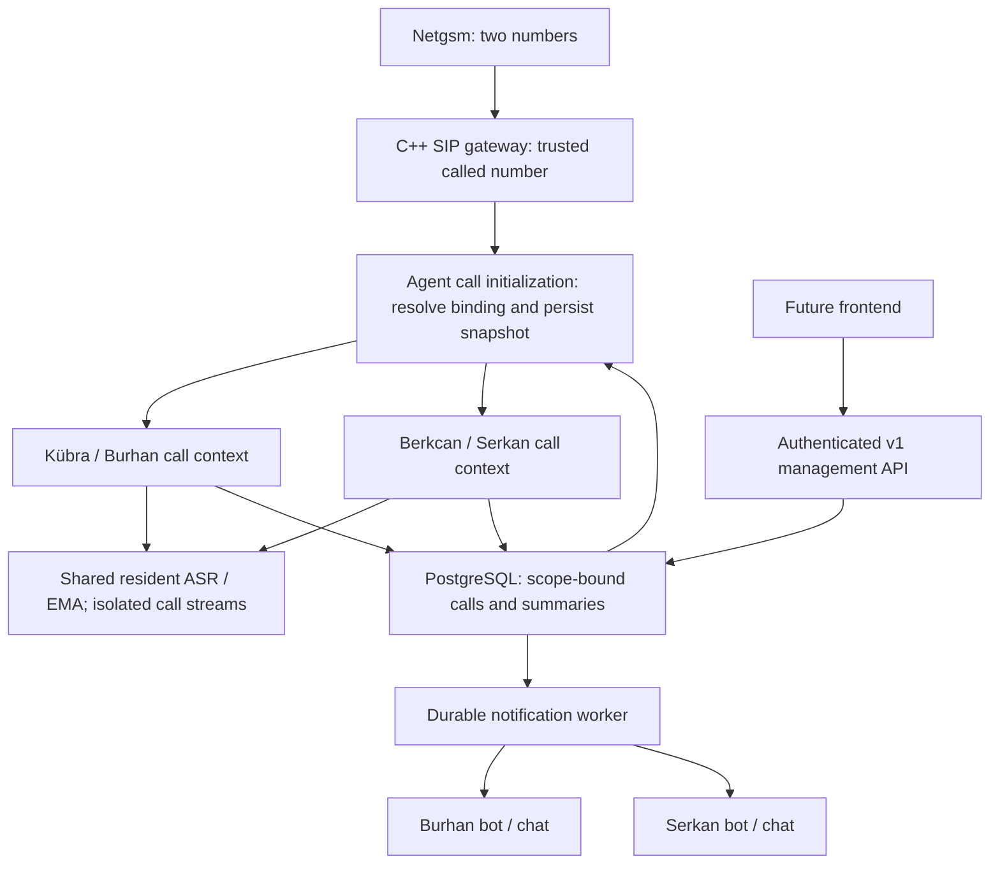

# Number, assistant and notification routing design

> Superseded target: [Voice agent platform](VOICE_AGENT_PLATFORM.md) and
> [ADR 0011](ADR/0011-self-service-voice-agents.md) now define user-owned workspaces,
> configurable built-in/MCP tools, agent-specific model/runtime settings and zero
> or multiple post-call actions. Administrator-only access, a mandatory single
> Telegram target, and global agent settings below are historical design choices.
> Existing migration 0003 is preserved; new capabilities require additive migrations.

Date: 2026-10-25. Design complete; PROF-02 configuration storage implemented, runtime integration and deployment pending.
Authority: [ADR 0010](ADR/0010-number-agent-profiles.md).
Requirements: §1–2, §5–6, §9–12, §14–15; US-01/02/03/05/07/08.

## Intended result and boundary

| Provisioned Netgsm number | Assistant | Represented recipient | Notification |
|---|---|---|---|
| Existing number (private) | Kübra | Burhan Bey | Burhan's configured bot and chat |
| Second number (not supplied) | Berkcan | Serkan Bey | Serkan's separate bot and chat |

Both assistants use the pinned EMA model/voice and existing approved LLM route.
An assistant name is not a voice selection. Each scope owns its profiles, numbers,
targets and records. Initially one trusted deployment administrator manages both;
recipient records are not login accounts. Separate customer login/RBAC and frontend
implementation are outside this change. API authorization is required from day one.

One direct SIP listener suffices for the initial host if both carrier routes
preserve a distinguishable called DID. Verify this on actual signaling; identical
destination headers cannot be disambiguated by guessing. Distinct trusted trunk
identities/listeners or ingress routing would then need explicit network design.
Do not add Kamailio/RTPengine just to configure two profiles; the larger deployment
continues to follow [ADR 0009](ADR/0009-call-capacity.md).

## Current code and required integration points

Graph discovery and source inspection on 2026-10-25 found:

- `LocalAccount.onIncomingCall` in `services/voice-gateway/src/main.cpp` checks
  capacity and transport source, then reads caller identity. No profile routing.
  `scripts/run-netgsm.sh` selects a global Kübra prompt directory.
- `services/agent/alojan_agent/backend.py` embeds Kübra/Burhan in role text,
  examples, tool descriptions, corrective speech and summary instructions.
  Replacing only the opening or top-level instruction is insufficient.
- `Store.start` in `services/agent/alojan_agent/store.py` persists caller data;
  no scope/profile binding is established. `summary_result` writes the summary
  and job status but does not enqueue routed delivery. Its callers include
  `AgentService.summaries` and both agent validation tools.
- `infra/migrations/0001_initial.sql` has `to_number_e164` and a generic outbox;
  `0002_agent_summary.sql` adds summary jobs. Extend these with new migrations,
  never rewrite applied migration files.
- `proto/voice/v1/voice.proto` has turn/playback/end RPCs, no pre-greeting profile
  initialization. `services/app-api` currently provides health/migrations, not the
  proposed management API. These are implementation gaps, not existing features.

Affected surfaces also include agent models/service/store, gateway session and
agent bridge, generated bindings, prompt assets, database/SIP/agent fixtures,
validation tools, deployment configuration and service documentation.

## Data model and invariants

All IDs below are opaque UUIDs; display names and phone numbers are not keys.
Use relational columns/foreign keys for identity and routing; bounded JSON only for
validated policy/snapshot content. Retain historical revisions while referenced.

| Entity | Minimum contract |
|---|---|
| `recipient_scopes` | ID, display name, enabled; Burhan and Serkan are separate rows |
| `assistant_profiles` | ID, scope ID, label, enabled; stable identity |
| `assistant_profile_revisions` | Profile ID + revision, assistant name, represented-person display/speech forms, greeting text and validated asset digest, bounded business context, availability wording, policy version, fixed approved voice/model references, creation metadata |
| `phone_numbers` | ID, scope ID, trusted trunk ID, normalized called E.164, enabled; unique `(trunk_id, called_e164)` |
| `notification_targets` | ID, scope ID, enabled; stable destination identity |
| `notification_target_revisions` | Target ID + revision, provider=`telegram`, expected bot ID, secret reference, numeric chat ID stored as string, verification state/time |
| `number_bindings` | Number ID + revision, scope ID, profile revision, target revision; immutable published mapping |
| `phone_numbers.active_binding_revision` | Atomically selected published binding; null means inactive |
| `calls` additions | Scope ID, number ID, binding/profile/target revisions, canonical called DID + provenance, validated immutable configuration snapshot |
| `notification_outbox` additions | Scope ID, pinned target revision, event type/version, state, lease token/expiry, attempts, due time, remote message ID, safe error code |
| `configuration_audit` | Authenticated actor, action, object/revision IDs, time; no tokens/transcript payloads |

Composite unique keys/foreign keys must enforce matching `scope_id` across number,
binding, profile, target, call and outbox. A valid UUID from another scope must fail
at both API and database boundaries. Child call data inherits scope through its
call FK; every read/write joins or checks that call's scope. No unscoped detail or
retry endpoint. The worker checks target scope against the call before dispatch.

One number has at most one active binding. A profile/target may serve multiple
numbers within its scope. Do not support cross-scope sharing or transfer of an
existing object. Deactivate and explicitly provision a new scoped object instead.
An active number requires a published profile and verified target; drafts may be
incomplete. Referenced revisions cannot be edited or deleted. New bot/chat values
create a new target revision and require re-verification.

## Trusted routing and call lifecycle

1. Validate SIP transport source/trunk and reserve the existing bounded call slot.
   On an untrusted peer, reject before parsing routing identity (403).
2. Parse a bounded called-number field using the PJSIP parser, normalize according
   to that trunk's confirmed prefix rules, and perform exact DID matching.
   Start with the Request-URI user only if carrier evidence confirms it carries
   the DID. `To` is an explicit per-trunk alternative, never a blind fallback chain.
   Conflicting authoritative fields are rejected. `From`/PAI identify the caller;
   Diversion/History-Info preserve forwarding evidence, not profile authority.
3. Add a typed `InitializeCall` RPC to the existing agent service. It accepts
   opaque call ID, trusted trunk ID, normalized DID/provenance and optional caller
   hint. Only the private gateway can call it; caller/model input cannot supply
   scope IDs or override the selected profile.
4. Outside SIP/media callbacks, resolve the active binding and referenced revisions
   in one consistent DB transaction and persist the call snapshot. Serialize
   publication and initialization on the number row: each call receives either
   the complete old binding or the complete new binding, never mixed revisions.
   The same call ID and identical initialization is idempotent; a conflicting
   initialization fails. Reply with the frozen greeting asset ID/digest and safe
   runtime profile metadata, never Telegram credentials or chat IDs.
5. Only after successful initialization and prompt readiness answer/play the correct
   greeting. Preserve the existing minimum three-second ringing delay, CANCEL
   behavior, ACK gating and PCM lead-in. Proposed initialization deadline: 2 seconds
   within ringing; expiry yields controlled failure, not an indefinite ringing loop.
   A late completion after CANCEL must end the initialized call idempotently and
   release resources without answering or producing a completed-call notification.
6. All turns, corrective phrases, tools, playback receipts and summaries use the
   same frozen profile. `RunTurn` references initialized call state; no profile ID
   from `context_json`, utterances or tool results can reroute it. Scope changes
   are not supported within a call.
7. BYE/CANCEL/error promptly releases media; idempotent `EndCall` updates persisted
   status. Summary and notification run afterward. Initialization makes even
   no-speech calls traceable. Crashed-call reconciliation marks known abandoned
   sessions as interrupted without inventing a successful conversation.

Unknown/inactive DID: 404; forbidden source: 403; capacity full: 486;
unavailable configuration/dependencies: 503. Log a sanitized internal reason.
Never route an unknown number to the legacy Kübra profile in multi-number mode.
Validate exact SIP behavior with native tests before carrier rollout.

No DB, HTTP or model operation belongs in a media callback. Use existing bounded
worker/event handoffs for initialization; cancellation and stale completion checks
remain authoritative. If DB resolution fails, reject new calls. Existing initialized
calls retain identity, but storage failures cannot announce that a note was saved.

## Profile publication and greeting assets

### Editable owner and assistant names

`owner_display_name` (the person represented for the number) and `agent_name`
are independently editable fields in each assistant profile revision. Kübra,
Berkcan, Burhan and Serkan are initial configuration values, never enum values,
routing keys or hard-coded product identities. The future profile editor exposes
both fields; the profile-revision API accepts them without a code change, service
restart or new Docker deployment. The scope's administrative label is separate
from the spoken owner name and is not a source for runtime identity.

Validate both names as trimmed, nonempty Unicode text of at most 100 characters;
reject control characters and treat names as data, not prompt instructions or
markup. Honorifics and Turkish inflected speech forms are explicit profile data,
not a universal hard-coded `Bey` suffix. A name edit invalidates derived speech
forms and greeting readiness until the revised values and regenerated greeting
are validated. Render greeting, identity answers, corrective speech, tool wording,
farewell, summary instructions and Telegram labels from the same revision.

Saving creates a draft revision. Publishing a binding activates the rename for
new calls only after its greeting is ready. Existing calls, historical records
and queued notifications retain their original name snapshot. Renaming changes
neither scope/profile/number IDs nor the bot/chat destination; it grants no access
and does not transfer ownership. An actual transfer between recipient scopes is
a separate provisioning operation. If several numbers share a profile, explicitly
select which bindings adopt the new revision rather than silently renaming all.

Acceptance: rename either field independently and both together; verify Turkish
characters, invalid/empty/oversized names, greeting regeneration, unchanged target
and IDs, and old/new call behavior across publication. Ensure no old name remains
in any new-call identity-bearing speech or summary, except as actual caller data.

Build prompts from validated structured fields and shared, versioned conduct
rules. Supply explicit Turkish speech forms (for example `Serkan Bey'e`) rather
than globally replacing strings in prompts or caller transcripts. Profile fields
cannot override tool permissions, delivery destination, AI disclosure or raw-audio
policy. Use the existing bounded business-context mechanism where suitable.

Greeting generation uses the resident EMA service in a bounded background job,
never a second EMA process and never a cold synthesis during SIP setup. Store
content-addressed, validated PCM/WAV artifacts in the existing asset layout with
text/model provenance, duration/format checks and the approved lead-in. A binding
cannot become active until its greeting is ready on the intended call server(s).
Reject arbitrary paths/URLs; profile publication uses validated asset IDs.

Publishing is an explicit transaction with optimistic revision checks. Editing a
draft does not affect calls. A new profile revision is activated by publishing a
binding; it does not silently update all numbers sharing the profile. Return the
effective binding revision and show the affected numbers for the future UI.
Deactivate a number to stop new admission without terminating established calls.
Keep referenced assets until all calls/revisions needing them are retired.

## API contract for the future frontend

Extend the existing app-api, with `/v1` JSON endpoints and an OpenAPI contract
generated/checked during implementation. All non-health endpoints require verified
administrator authentication. Bind privately; if exposed through Cloudflare Access,
validate token audience/issuer/signature and prevent direct-origin bypass. Do not
trust arbitrary identity headers. If cookie authentication is used, require CSRF
protection and same-origin/CORS restrictions. Do not build custom account signup.

| Endpoints (proposed) | Purpose |
|---|---|
| `GET/POST /v1/scopes` | List/create recipient scopes |
| `GET/POST /v1/scopes/{scope}/profiles` | List/create profiles and initial drafts |
| `GET /v1/scopes/{scope}/profiles/{id}` | Revision history and publication readiness |
| `POST /v1/scopes/{scope}/profiles/{id}/revisions` | Create validated immutable candidate revision; enqueue greeting preparation |
| `GET/POST /v1/scopes/{scope}/notification-targets` | List/create Telegram targets; return masked metadata only |
| `POST /v1/scopes/{scope}/notification-targets/{id}/revisions` | Create destination/credential revision |
| `POST /v1/scopes/{scope}/notification-targets/{id}/verify` | Explicit synthetic test delivery for specified revision; record confirmation |
| `GET/POST /v1/scopes/{scope}/numbers` | List/provision canonical DIDs for known trunks |
| `PUT /v1/scopes/{scope}/numbers/{id}/binding` | Atomically publish profile + target revision after readiness checks |
| `POST /v1/scopes/{scope}/numbers/{id}/deactivate` | Stop new calls; preserve historical bindings |
| `GET /v1/scopes/{scope}/calls[/{id}]` | Paginated scoped list/detail with selected profile and delivery status |
| `POST /v1/scopes/{scope}/notifications/{id}/retry` | Retry pinned job; never accept a replacement recipient in the request |

Use `If-Match`/ETag for binding updates and deactivation; missing precondition 428,
stale revision 412. Validate structured input (422), conflicting DID or unready
publication (409), authentication (401), authorization (403), and invisible/missing
scoped objects (404). Bound request sizes and pagination. An `Idempotency-Key` on
create/verify/retry is scoped to actor+operation; same key/different body is 409.
Retries of an already delivered job return its state without sending again.

The UI can later present scopes, profiles, numbers, notification targets and a
mapping editor with draft/readiness/published states. It calls this API exclusively.
Secrets are write-only; API responses show credential-present status and bot ID.
Never include a token in an OpenAPI example, audit event, URL log or frontend cache.

## Telegram delivery semantics

Store bot tokens behind an opaque secret reference, separate from configuration
and call snapshots. Initially use an access-restricted host credential directory,
atomic writes, generated filenames and mode 0600; only the management credential
writer and notification worker need access. The LLM/gateway never receive tokens.
No arbitrary filesystem path is accepted from the API. Rotate credentials with
expected bot-ID verification; changing bot identity creates a new target revision.
Backups must protect both configuration and separately encrypted credentials.

The recipient starts/authorizes the bot chat; the administrator supplies its chat
ID privately and explicitly verifies the target with a synthetic message. Verification
is an external write, shown as such in the future UI; saving a draft sends nothing.
Telegram credentials/recipient provisioning remain a deployment prerequisite.

On summary finalization, commit the immutable event payload and outbox row in the
same transaction as the summary/job result. Unique `(call_id, event_type, event_version)`
prevents duplicate completion jobs. Destination comes from the call snapshot,
never the latest number binding. Freeze payload on enqueue; subsequent corrections
are separate audited events, not silent replacement of a pending message.

Default result: one concise plain-text message containing assistant/recipient,
call time and opaque reference, caller name/number if available, reason/message,
callback request and call outcome. No raw recording or full transcript. A call
without usable content gets an explicit no-message result; canceled pre-answer
calls generate no completion message. Exhausted summary failure produces a bounded
metadata-only failure result, never an invented summary. Target 3500 characters
including metadata and mark truncation; keep full authorized details in PostgreSQL.

Use a fixed Telegram HTTPS endpoint, validated TLS and no cross-host redirects;
never accept a user-configurable URL. Disable parse mode/link previews to keep
caller text inert. The documented `sendMessage` limit is 4096 characters and the
API can return `retry_after` for flood control. Source checked 2026-10-25:
[Telegram Bot API](https://core.telegram.org/bots/api#sendmessage).

Claim due jobs atomically (`FOR UPDATE SKIP LOCKED` with lease token/fencing),
release the transaction before network IO, and update only with the matching lease.
Keep HTTP deadline shorter than lease; do not hold DB connections during sends.
Lease expiry after dispatch is ambiguous, not automatically safe to resend.
Bound per-bot/global work; an unavailable bot cannot starve another bot's queue.

States: `pending`, `sending`, `retry_wait`, `delivered`, `failed`, `delivery_unknown`,
`paused`. Honor retry-after for explicit rate rejection; retry clearly unsent
connection failures with bounded exponential backoff/jitter (initial policy: eight
attempts, at most 24 hours). Permanent credential/chat errors fail visibly.
If a request might have been accepted (timeout after dispatch, lost response,
crash before recording success, ambiguous server error), set `delivery_unknown`.
An administrator may explicitly retry with a possible-duplicate warning; preserve
the same call reference. Local job deduplication is not exactly-once Telegram
delivery. Store remote message ID on confirmed success and redact token-bearing
HTTP paths, exception bodies and private message text.

Revoking/disabling a target pauses all unsent jobs for that target, including
frozen old revisions; it never redirects them to another bot. A send already in
flight cannot be recalled. Revocation is a delivery safety control, not a rewrite
of historical ownership. A recipient change affects new calls only.

## Migration, deployment and rollback

1. Add schema and indexes with a new migration. Keep legacy rows/columns intact.
   Seed Burhan/Kübra from the current approved behavior; create Serkan/Berkcan as
   inactive drafts. Never invent real numbers, chat IDs or tokens. Scope only
   historical calls verified as Burhan's; quarantine ambiguous legacy records.
2. Implement scope-aware store, profile renderer, management API, initialization
   RPC and notification worker. Regenerate both binding sets with pinned tooling;
   do not change existing protobuf field numbers. Add runtime capability checks.
3. Retain explicit legacy single-number mode for old gateway tests/rollback only.
   Multi-number mode requires successful initialization; never permit missing
   metadata to select a default owner. Upgrade consumers before activation.
4. Apply isolated Linux migrations/tests, then provision private DIDs and bot/chat
   pairs. Legacy outbox entries remain paused unless explicitly reviewed; enabling
   Telegram must not send historical calls. Prepare/verify both greeting assets.
5. Resolve the existing carrier reachability incident. Verify direct and forwarded
   called-DID behavior for each line, then activate bindings. Initially retain the
   qualified global one-call limit. Two registered numbers can work sequentially;
   overlapping calls require CAP-02–05 and measured two-call acceptance first.
6. For rollback, deactivate the second number, stop new admission and drain calls;
   pause delivery workers before reverting binaries. Keep additive schema/history.
   Do not run an old single-profile gateway while both numbers still route to it.
   Revert number publication/network routing explicitly, without deleting notes.

There is no second GPU stack, new broker or public management service in this
design. Current model/latency/capacity/carrier limitations remain open. New runtime
dependencies require pins/license review when selected; this design adds none.

## Implementation tasks and acceptance

| Task / milestone | Deliverable and acceptance | Requirements |
|---|---|---|
| PROF-01 / M0 | ADR, requirements, schema/API/lifecycle design and acceptance matrix | §1–2,11,18 |
| PROF-02 / M0,M4 | Additive migrations, scoped repository, immutable revisions and migration/ownership constraints | US-07/08; §11,14 |
| PROF-03 / M1,M4 | Trusted DID resolution, InitializeCall, pinned profile greeting and full agent/summary identity rendering | US-01/02/03/05/08 |
| PROF-04 / M5 | Authenticated management API, secret handling, audit, publication preconditions, OpenAPI | §10,12,14; US-08 |
| PROF-05 / M4,M5 | Atomic summary/outbox, leases, Telegram delivery/retry/unknown states | US-07/08; §9.4,11 |
| PROF-06 / M1–M5 | Isolated Linux validation and two-profile fault/isolation tests | US-01–08; §15 |
| PROF-07 / M1,M5,M6 | Per-line carrier/DID and bot acceptance, controlled rollout/rollback; overlap gated on CAP work | US-01/03/07; G2/G3/G5/G6/G7 |

Order: PROF-02 precedes 03/04/05; all precede 06 and live 07. Reuse the existing
store/outbox and SIP fixtures, not a parallel persistence or orchestration layer.

Required tests:

- DB rejects cross-scope binding/call/outbox relations, duplicate DID and mutation
  of referenced revisions; publication races yield one complete binding. Backfill
  and legacy outbox tests prove no historical automatic sends.
- SIP synthetic calls for both DIDs speak correct AI identity; unknown/malformed/
  conflicting DID, spoofed headers, forwarded caller, busy, failed initialization,
  duplicate INVITE, CANCEL during lookup and late replies release resources safely.
- Every identity-bearing path (greeting, identity question, correction, note/tool
  wording, farewell, summary) uses Kübra/Burhan or Berkcan/Serkan consistently.
  Profile text cannot change recipient or tool authorization. No cross-call state.
- Change binding/profile/target during a call and again before delivery; old call
  retains old revisions, new call uses new revisions. Disable target and verify
  pending jobs pause rather than leak to a replacement recipient.
- API authentication, scope/IDOR rejection, secret redaction, input limits,
  conflicting updates, replay/idempotency, CSRF where applicable, unready asset
  publication and path/URL injection. No production token or phone in fixtures.
- Fake Telegram transport: success, duplicate enqueue, concurrent workers, 429,
  permanent error, unsent connection failure, response loss, lease expiry/crash,
  manual retry, target revocation and queue fairness. Verify exactly the selected
  synthetic bot/chat and no tokens in logs. Fakes do not prove Telegram acceptance.
- Real Linux sequential two-profile CUDA/API calls first; overlapping speech only
  after shared inference capacity work. Measure latency, cancellation and isolation.
  Test both real carrier lines and bot/chat deliveries separately with owner access.

Record sanitized outcomes in PLAN and CALL_TEST_PLAN; never collapse local mocks,
Linux integration, GPU performance and carrier/Telegram evidence into one pass.

## Evidence for this design change

Local source/schema/contract inspection and official Telegram documentation informed
the design. SSH to the configured Linux host timed out on 2026-10-25, so no remote
sync, migration, runtime check or deployment was performed. Local documentation
checks are recorded in PLAN. No private numbers, tokens, messages or audio were
created or transmitted. Implementation tasks PROF-02–07 remain pending.

## PROF-02 storage implementation follow-up

`infra/migrations/0003_profile_settings.sql` implements recipient scopes, profile
identities, immutable profile revisions and a typed `system_settings` singleton.
Profile names, role/tone, availability/greeting, response limits, further-help and
recovery/summary wording are stored per revision. System defaults cover model,
provider, generation limits, timeouts and safety flags. Mandatory security flags
cannot be disabled through SQL. Profile voice/language remain the approved EMA/TR.
See [SQL examples and execution boundary](../infra/examples/README.md).

This is a partial PROF-02 delivery: number/notification bindings, call snapshots,
asset preparation, runtime reads, management API and Telegram dispatch still need
implementation. Shared conduct rules are enforced code policy, not arbitrary SQL
instructions. Existing agent constants remain until validated consumers are wired.
Linux isolated PostgreSQL tests: 24 passed, no skips; Ruff lint/format passed.
No production schema migration or runtime restart occurred.
