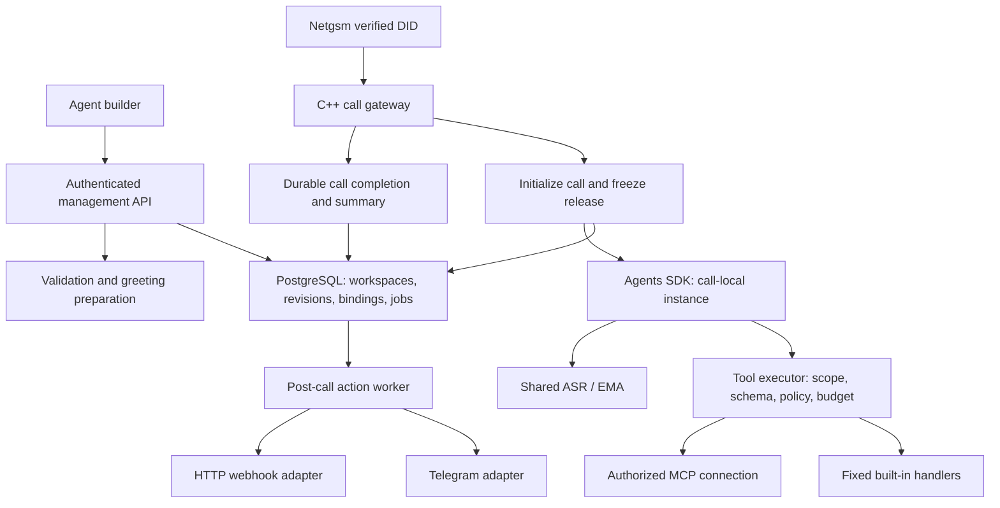

# User-managed voice agent platform

2026-10-27: AGP-03/06/09 activation/restart fixes are deployed. Management pins the
node assignment on publication; the node discovers/preflights current publications
without restart. Individual release failure cannot prevent healthy agents from
starting. Binding remains explicit and unique per number; existing calls keep their
release. [Evidence and limits](validation/publication-activation-2026-10-27.md).

Deployment update (2026-10-27): compatible MCP/HTTP/lifecycle readers and UI are now
active on the authorized Linux private deployment, including dedicated MCP discovery
and a pinned matching voice-preparer. Existing Kübra routing/model/EMA are preserved;
new tool/action configurations still require owner configuration and grants. Earlier
candidate-only notes below are historical. Summary quality is deferred by the owner;
latest-release end-to-end, performance/load and full rollback acceptance remain open.
[Deployment evidence](validation/platform-rollout-2026-10-27.md).

AGP-07 qualified-schema update (2026-10-26): bounded nullable/default/wrapped-output
compatibility is implemented in candidate release v8 / MCP review v2. Raw tool digests
remain pinned beside deterministic qualified schemas. The authorized Hindsight target
passed real discovery (39 tools) and one fixed-argument `list_banks` read (empty result,
0.794s), including blocked override and post-revocation attempts. This supersedes
pending real-server read acceptance below only for that exact tool and none-auth mode.
Other tools, OAuth providers, serving activation and voice/load acceptance remain open.
[Contract and evidence](validation/mcp-schema-2026-10-26.md).

AGP-07 OAuth update (2026-10-26): candidate migration 0023 adds session-bound PKCE
flows and encrypted rotating credentials. Owner-reviewed provider login/callback,
background renewal and readiness/revocation checks are implemented for preregistered
public clients. Tokens never reach the browser or turn-time refresh path. Operator
registry and role setup are described in the management README. Real approved-provider
acceptance and coordinated deployment remain open; this is not universal OAuth support.

AGP-07 builder update (2026-10-26): candidate Next.js screens now cover MCP
connections, explicit discovery, reviewed tool selection, typed fixed parameters,
exact owner consent and historical grant revocation. Linux browser acceptance is
complete for none/Bearer authentication with synthetic external metadata; real OAuth,
real-server acceptance and serving activation remain open. No media-path changes.
See [builder evidence](validation/mcp-ui-2026-10-26.md).

AGP-07 runtime update (2026-10-26): discovery (0020), reviewed selection/owner
consent (0021), and immutable MCP releases with bounded call execution (0022) are
implemented in the candidate. Version 3 pins exact tools/parameters/consent; background
permission refresh and call-local fences enforce revocation. Invalid/late outputs are
rejected and validated results receive scoped immutable evidence. A revoked MCP agent
does not remove unrelated agents' readiness. That runtime slice did not include
serving activation, OAuth or builder UI (the latter is covered above).
See [runtime evidence and limits](validation/mcp-runtime-2026-10-26.md).

Current AGP-03 update (2026-10-25): the private node-local coordinator now validates
and pins installed releases, probes speech configuration, renews fenced/expiring DB
receipts and supplies process-local admission permits. A real native Session test
uses normal AgentService without forced readiness. Legacy startup remains unchanged;
trusted deployment targets now have an explicit isolated launcher with startup/stop
cleanup and reconciliation. Scoped encrypted provider connections now bind credentials
to each release; the separate summary worker consumes historical scoped jobs without
the legacy key or notification loop. Workspace-scoped Telegram destination storage
now has an owner-only write/revoke API and encrypted tokens; it does not authorize,
verify or execute sends. Agent action selection, exact owner consent, revocation and
immutable schema-v2 release/grant bindings are implemented for up to four Telegram
actions and 23 declared scalar output paths. Scope-specific grant state is stored in
`action_grants` (the post-call portion of planned execution grants). Migration 0014
and the independent delivery process now atomically schedule selected final-event
fields, enforce original grant/target/issuer at dispatch, fence attempts and preserve
uncertain sends without automatic replay. Schema-v2 runtime/preload support is enabled;
this is capability support, not a running-worker or remote-delivery readiness receipt.
Scoped outcome and owner-reviewed retry APIs now preserve exact original intent,
explicit duplicate-risk consent and immutable round history (0015). The worker rechecks
requester membership and consumes approved rounds once. Frontend, general tools/actions
and real quality/PERF remain pending. Historical status paragraphs below are superseded for these implemented
consumers only. Connection replacement requires a new reference/release; no in-place rotation.

Date: 2026-10-25. Authoritative target design under
[ADR 0011](ADR/0011-self-service-voice-agents.md). Native authentication and scoped
draft authoring and immutable prepared-release publication are implemented under AGP-02;
number binding, the admission repository, private setup RPC boundary and tested native
DID parser are implemented. Native INVITE/setup/answer/CANCEL and prepared playback
are exercised in an explicitly loopback-only test profile. Production setup remains
not-ready: remaining speech/runtime consumers and routing activation are pending.
Call-local Python prompt/model/tool/recovery/summary consumers now compile the pinned
release, with scripted/DB/loopback evidence; verified greeting/unavailable PCM and
compiled runtime now preload into a bounded cache and are pinned at initialization.
Private lease-bound PCM transfer and native playback are tested through real gRPC
and PJSIP media ports; the isolated Session/INVITE profile selects prepared output.
Scoped call records, leased summary claims and atomic immutable finalization now have
isolated PostgreSQL evidence. Native ACK/end reports and node-scoped recovery now use
those repositories in the isolated SIP profile, including repair of lost writes.
The independent worker service, configured action fan-out and remaining conversational
consumers/readiness remain pending. This does not enable production routed calls.
Pinned ASR vocabulary now has validated authoring, immutable compilation and a
lease-bound recognition RPC; DB/gRPC tests use scripted inference. Native setup
forwards it in the isolated SIP profile, and a native probe verifies turn/monitor
lease continuity. Full routed Session integration and live strict-worker activation
remain pending, with ordinary readiness still false.
See [management implementation and limits](../services/app-api/README.md).
Extends PROF-01–07 into AGP-01–09 below. Existing migration 0003 is storage groundwork,
not a working agent builder. This document takes precedence over the earlier
[profile routing plan](PROFILE_ROUTING_PLAN.md) where scope or ownership differs.

## Configuration completeness gate

The [configuration audit](AGENT_CONFIGURATION_AUDIT.md) is mandatory for AGP-02–09.
CFG-01–18 covers identity, all deterministic/model speech, intent policy, model,
context/output limits, native timing, ASR vocabulary, TTS chunking, assets, tools,
MCP, actions and budgets. Every configurable field has an explicit user/system owner and needs an actual consumer and
observable test; database storage alone is not completion. A versioned effective
configuration drives Python/native contracts without per-turn management calls.
Protocol constants and non-disableable safety/resource ceilings remain explicit.

## User journey

1. Sign in and select an authorized workspace. A person may belong to multiple
   workspaces; changing the UI selection never grants access to another workspace.
2. Add an 0850 number and complete carrier possession/routing verification.
3. Create an agent: owner/assistant names, greeting, instructions, business context,
   supported EMA voice and approved model/connection choice; optimized engine settings apply automatically.
4. Select tools from the system catalog. Fill each tool's configuration form;
   add scoped credentials through write-only controls. Instructions explain when
   to use selected tools. Configuration and authorization constrain execution.
5. Optionally create an MCP connection, authorize it, discover available tools and
   select individual reviewed tools for this agent. No automatic whole-server grant.
6. Configure post-call actions separately: Telegram initially; a later HTTP request
   builder selects event fields and declared tool/agent outputs for its payload.
7. Validate, preview effective instructions/tools/request mapping, run synthetic
   tests, listen to generated greeting, and publish an immutable release.
8. Bind a verified number to that release. Inspect calls and action delivery status;
   edit a draft or publish a rollback release without rewriting past calls.

A number has one active binding; an agent release can serve multiple verified
numbers in the same workspace. No hidden default agent for unknown DIDs. Users
cannot purchase/provision carrier service merely by adding a database record.
Owner clarification (2026-10-27): only one agent may receive new calls for a number.
Selecting another release atomically replaces that number's active binding; historical
bindings are not additional active agents. Concurrent changes with the same number
version cannot both succeed. Calls already admitted retain their original release.
Automatic selection or distribution between agents is outside the current scope.
The initial two configurations remain Kübra/Burhan and Berkcan/Serkan, but neither
names nor the count of agents are hard-coded. Users share existing inference workers.

## Service boundaries

Owner-required deployment: management HTTP is a separate `services/app-api`
application/image and Docker service `management-api`; background delivery runs
as a separate `action-worker` service. Neither is embedded in the voice agent.
The [performance plan](AGENT_PLATFORM_PERFORMANCE_PLAN.md) defines cache/loading,
resource limits, baseline comparisons and rollout gates. Live voice never calls
the management HTTP API. Netgsm remains the only carrier: SIP/NAT/source/prefix
configuration stays in private host configuration; no generic operator catalog,
user trunk setup, REGISTER credentials or carrier-management UI is planned.
Users only bind their verified Netgsm numbers to agents.




The management API does not carry live audio. Tool/network/database work never
blocks SIP/media callbacks. Reuse existing functions/store contracts and the outbox;
separate logical modules before considering new services. The action worker runs
outside the media/agent turn lifecycle. PostgreSQL remains the durable job queue.

## Ownership and authentication

Owner follow-up (2026-10-25): use Alojan-owned authentication, not an external
OIDC dependency. Use immutable user UUIDs, unique normalized login names, scrypt
password verifiers and revocable opaque server-side sessions. Public registration
atomically creates a private workspace and its owner membership. Every registered
user may create and publish their own agents; number binding still requires proof
of ownership/routing. No per-user container or operator publication approval is
required. There is no default password. Password recovery is an audited operator command
until a verified delivery channel is configured. Password changes/recovery revoke
existing sessions. Cookies are Secure/HttpOnly/SameSite, mutations require origin
and CSRF checks, and password work has separate concurrency/rate limits.
Use workspace memberships with owner/editor/viewer roles. Owner manages members,
credential grants and publication of external actions; editor drafts/tests permitted
configurations; viewer reads only permitted records. Platform administration is a
separate permission, not implicit access through a supplied workspace ID.

Every number, agent, revision, connection, secret reference, tool configuration,
call and job belongs to one workspace. Enforce composite foreign keys and scoped
repository queries. Add PostgreSQL row policies for tenant-bearing tables using
a non-owner runtime role; set workspace context transaction-locally and test pooled
connection reuse. Migration and cross-workspace worker roles are separate; workers
claim jobs then bind the recorded workspace, never user-supplied context. RLS is
additional protection, not a substitute for authorization. Membership/revocation
is checked on every management operation. Audit privileged cross-workspace access.

A number begins `pending_verification`. Establish possession through an audited
carrier-account proof/administrator review and a controlled routing verification;
do not invent a Netgsm API or rely only on caller ID/SMS. Record evidence metadata,
verifier and time without private captures. A globally unique active DID ownership
constraint prevents another workspace claiming the same number through a different
trunk row. Transfer requires explicit release/verification and draining; it never
transfers historical calls. Use the carrier-confirmed called-DID source, exact
normalization and fail-closed routing rules from PROF-03.

## Configuration and revision model

Keep `recipient_scopes.id` as the workspace key initially; add membership metadata
rather than creating a second competing scope identity. `assistant_profiles` and
`assistant_profile_revisions` remain agent identities/content revisions. New
relations reference these names; API may present them simply as agents.

| Entity | Responsibility |
|---|---|
| `users`, `workspace_memberships` | Verified login identity and workspace roles |
| `phone_numbers`, `number_verifications`, `number_bindings` | Verified DID ownership, immutable release binding, current pointer |
| `assistant_profile_revisions` extension | Bounded editable instructions, names, tone, business context and speech templates |
| `agent_runtime_revisions` | Agent model/credential selection and immutable engine preset reference; resolved effective digest |
| `engine_presets` | Operator-owned versioned model/audio/runtime tuning, qualified defaults and capability bounds |
| `tool_definitions` | System-owned versioned handler key, phase, model input schema, fixed config schema, output schema, risk, timeout/retry capabilities |
| `agent_tool_configs` | Agent revision, tool definition/version, safe alias, enabled, fixed values, secret refs, allowed argument bounds, usage guidance and grant |
| `mcp_connections` + revisions | Workspace endpoint, transport/auth metadata, secret refs, verification status |
| `mcp_tool_manifests` | Discovered tool names, schema/description hashes, reviewed capability/risk and connection revision |
| `agent_mcp_tool_configs` | Explicit tool subset, fixed/runtime argument separation, limits and grants |
| `post_call_action_configs` | Agent revision, fixed adapter/version, event/filter, target config, typed mapping, secret refs and grant |
| `agent_releases` | Immutable complete manifest of profile/runtime/tool/MCP/action/asset revisions and digest |
| `calls` extension | Workspace, number, pinned release, effective nonsecret settings, provenance, outcome |
| `tool_executions`, `action_jobs` | Scoped execution journal, idempotency, attempts, bounded outputs, delivery state |
| `execution_grants`, `configuration_audit` | Who authorized what scope/configuration, expiry/revocation and change history |
| `platform_settings` + capability catalogs | Shared infrastructure, hard ceilings, supported providers/models and defaults |

Each relation uses same-workspace foreign keys; also require the referenced profile
ID to match, not just its workspace. Config rows can reference only reviewed catalog
versions. Immutable config rows belong to a release; editing creates a new revision.
A release's manifest is finalized atomically after all validation/artifact jobs.
Independent draft edits cannot leak into a published agent. Use ETags and explicit
publication. A rollback republishes a previous manifest as a new release, subject
to current revocations/capability validation. Calls pin release at initialization.

Secrets never appear in JSON settings, compiled prompts, manifests, exports or
logs. Only opaque workspace-bound secret references are stored. Credentials are
encrypted with keys outside the database; execution identities get only required
secrets. Rotate credentials for the same external identity without redirecting an
old job; a new account/endpoint requires a new connection/action revision. Revocation
can stop pending/in-flight future attempts even when the configuration is pinned.

## User choices and system-managed optimization

The owner's latest clarification supersedes exposing every runtime detail in the
agent editor. Users configure business intent, not speech-engine tuning. The
system supplies tested technical presets automatically; no advanced user override
for engine internals in the initial product.

| Owner | Configuration |
|---|---|
| User, per agent | Owner/assistant names, instructions, business context, tone, greeting/farewell wording, availability wording, further-help preference, business vocabulary, selected supported model/provider connection, tools/MCP and their business parameters, output fields, summary content and Telegram/HTTP actions |
| System-managed engine preset | Reasoning/temperature/token defaults per model, context/turn budgets, truncation, reply byte/phrase caps, deadlines/retries, VAD/endpoint/barge-in/echo, silence recovery timing, ringing/closing/drain, ASR cadence/decoder settings, TTS chunking/seed/normalization, waiting-audio timing/level and technical call limits |
| Platform/deployment | Netgsm connection, ports/NAT, shared GPU residency, worker/DB pools, transport/queue caps, aggregate quotas, retention ceilings, mandatory security and deployment configuration |

Allow user-friendly tone or brevity instructions without asking users for token,
millisecond, frame or buffer values. A user may add a business pronunciation or
term through validated vocabulary; the system controls the decoding algorithm.
Prepared voice asset selection remains supported EMA only. Required disclosure,
truthful execution and data isolation cannot be weakened by instructions.

Users can retain model choice from the approved catalog. Each entry references
a validated engine preset and supported credential connection; reasoning,
temperature and provider routing are chosen by that preset, not exposed as tuning
sliders. Different models may require different technical values, while agents
using the same model/preset share those values. No silent model/provider fallback.
Unsupported models or combinations are unavailable until qualified.

Introduce immutable `engine_presets` owned by platform operators. An agent release
stores user-owned configuration plus `model_catalog_revision` and
`engine_preset_revision`; its resolved nonsecret effective configuration is pinned
for runtime/reproducibility. System ownership does not mean mutable global state:
no shared SDK instance changes per call, no per-turn lookup, no surprise updates
to active calls. Preset defaults are applied automatically at creation/publication.

Preset rollout is a controlled platform operation: benchmark against the known-good
preset, generate new effective releases for eligible agents, preserve their business
config/model/tool grants, canary new calls and roll back on regression. Existing
calls and queued actions keep original snapshots. Users need not retune or manually
edit each agent to receive a validated engine upgrade. Operator visibility includes
versions, effective settings and affected agents; the ordinary editor stays simple.

Migration 0003 stays unchanged. A future additive migration copies technical system
values into the initial engine preset once, retains genuine global deployment
controls separately, and preserves user content in profile revisions. Do not clone
every technical field into each agent as a user override. `agent_runtime_revisions`
becomes the binding of model/credential choice to an engine preset, not a second
mutable tuning table. Enforce no dual read precedence. DB/API/Python/C++ bound
mismatches found in CFG review must still be fixed before preset activation.

## Instructions and Agents SDK construction

Compile: immutable platform security/conduct rules + selected agent instructions
+ resolved nonsecret tool usage descriptions + call-local context. The editor
provides a free-text instruction field so owners can describe which tool to use
when; validated fixed configuration is not embedded as arbitrary instructions.
Instructions cannot create tools, approve actions or set credentials. Tool outputs,
caller text and retrieved content remain untrusted input.

Build a call-local SDK agent using the pinned model config and an explicit tools
list. Do not mutate shared global instructions, model settings or tool closures.
Reusing a transport client is allowed only with safely isolated credentials/state.
Core voice protocol tools (`respond`, `finish_call`) remain mandatory internal
capabilities; show their purpose but do not permit a selection that makes speaking
or termination impossible. `take_note` and subsequent business tools are selectable.
If note collection is enabled, validate that `take_note` is present. A no-note agent
must never claim it recorded a message; summary availability is a separate setting.

Maintain tool schema compatibility, structured validated speech, sent-audio accounting,
cancellation and bounded SDK turns. General core policy must stop assuming every
agent is Burhan's receptionist. Business workflow lives in agent instructions;
security and truthful execution reporting remain shared rules. Synthetic evaluation
must cover selected tools, declined tools and incorrect tool choices before release.

## Built-in tool catalog and parameter ownership

Executable tools are fixed application code registered by deployment, not uploaded
by users. Catalog entries have immutable versions and separate schemas:

| Parameter source | Example | Who supplies it? |
|---|---|---|
| Runtime/model arguments | Message text, lookup query | Model, then server validation |
| Agent fixed configuration | Project identifier, allowed category | Owner's tool configuration form |
| Server execution context | Workspace/call/release IDs | Authenticated runtime only |
| Secret configuration | API token | Scoped secret provider only |

No parameter may belong to two sources. Remove fixed/server/secret fields from
the model-visible schema; reject attempted overrides instead of merging untrusted
input over configuration. Validate the complete request again before execution.
One catalog definition may have several configured instances per agent with unique
safe aliases; the model sees each instance's purpose and permitted runtime inputs.

Tool executor checks the release selection, workspace grant, live revocation,
argument schema/bounds, quota and remaining deadline before each invocation.
External writes require either a recorded standing owner grant for that exact
configuration or per-invocation owner approval. A save/publish screen explicitly
lists destination, operations and data scope when granting standing authorization.
Prompt text, merely ticking a checkbox and caller agreement alone are not grants.
Without timely approval, report unavailable/deferred; never hold RTP waiting for
an administrator indefinitely or execute a stale approval after the call ends.

Persist invocation ID and typed output before downstream use. Reads may retry
within deadline; writes retry only with provider idempotency or proof of non-send.
Cancellation stops delivery of stale results but cannot undo a completed external
write. Record that outcome without claiming rollback. Bound output size and return
only declared, redacted model-visible fields. No arbitrary shell/SQL/code tools.

## MCP configuration and discovery

The UI supports workspace connections with name, approved HTTPS Streamable HTTP
endpoint, authentication choice, write-only credentials/OAuth connection, bounded
timeouts and connection test. Initially allow read tools; write tools require the
same grants/idempotency assessment as built-ins. Local stdio commands are operator-
provisioned only; never run a user's arbitrary MCP launch command on the server.

Discovery is an explicit background operation. Persist and review name/schema/
description hashes, display tools with required arguments and risk, then select a
subset per agent. MCP annotations are hints, not proof a tool is read-only.
Changing a server's manifest does not silently add capabilities: incompatible
selected schemas invalidate readiness until reviewed and republished. Use stable
namespaced aliases and reject collisions. Enforce connection identity/credential
isolation; do not share authenticated sessions across workspaces.

If selected required tools cannot resolve at admission, mark the release unready.
An explicitly optional unavailable tool returns a controlled error during a call;
never substitute another server/tool. OAuth state/PKCE and audience/resource
binding, minimal scopes, token storage/refresh, revocation and callback validation
belong to the connection layer. Never pass the user's application login token to
an MCP server. Apply SSRF controls to discovery/auth URLs as well as tool endpoints.
The existing `owner_read_adapter` is an unconnected allowlist boundary, not this
implemented connection manager. Pin protocol/SDK compatibility when building it.

## Post-call actions and typed output mapping

These are deterministic event-triggered adapters, not tools the LLM decides to call.
They use the same catalog/config/secret concepts but phase=`post_call`, executed
by the action worker. Telegram and HTTP request handlers are system-defined code.
An agent may configure zero or several independent actions, each with its own
condition and delivery status. The current candidate enables Telegram and the bounded
HTTP scalar-field slice; expanded conditions/output extraction remain planned.
One failed action must not replay successful actions or block unrelated calls.
No general DAG or action-to-action output chaining is needed in this version.

Finalize media independently. Persist call outcome and summary work durably;
when summary succeeds or reaches terminal failure, create versioned
`call.finalized.v1` and its eligible jobs transactionally. Default filter is answered
calls; optional no-answer/interrupted/summary-failed filters are typed enums shown
in UI. A missing summary is explicit null/status, not fabricated text. Retrying
summary computation after finalization never repeats old actions automatically;
any correction event/replay is a separately authorized operation.

Event field catalog includes opaque call ID, verified called number, caller identity
with provenance, timestamps/duration/outcome, pinned agent names, summary status/
fields, latest durable note, declared validated extraction fields, and approved
redacted tool-output fields. Raw transcript is opt-in with visible disclosure and
access policy; audio, secrets, reasoning and arbitrary internal context are excluded.
Custom extraction fields use an owner-defined bounded schema (strings, numbers,
booleans, simple arrays), model extraction with validation, unknown/null semantics
and no execution authority. A tool exposes fields only through its output schema;
select an explicit rule such as last successful result per tool instance. No
cross-call or cross-workspace lookup through a mapping path.

HTTP request editor (current scalar-field candidate; richer sources remain planned): HTTPS destination, POST/PUT/PATCH method,
static approved headers, scoped authentication, and structured JSON body/query
mapping. Each destination field is a literal or a typed field reference with
explicit missing policy (`null`, `omit`, `fail`). Fixed origin; path/query values
are encoded and cannot change host/scheme. For example, design-only configuration:

```json
{
  "adapter": "http_request.v1",
  "method": "POST",
  "url": "https://example.com/call-results",
  "body": {
    "reference": {"source": "call.id", "on_missing": "fail"},
    "reason": {"source": "summary.subject", "on_missing": "null"},
    "ticket": {"source": "tools.support_lookup.last_success.ticket_id", "on_missing": "omit"}
  }
}
```

This syntax is a proposed declarative mapping contract, not an executable script.
Use a JSON serializer, no eval/Jinja/JavaScript/SQL expressions or string-concatenated
JSON. Restrict field count/depth/value size and total payload (initial cap 64 KiB).
Preview with synthetic data and redact secrets. A network test is explicit and
uses synthetic values; saving configuration sends nothing. Grant publication must
show exactly which data leaves the workspace and to which destination.

HTTPS egress denies loopback/private/link-local/metadata/multicast ranges in IPv4
and IPv6; validate DNS at connection time and pin vetted resolution against rebinding.
No redirects by default; no URL credentials, arbitrary Host headers, proxy setting
or dynamic auth headers from call data. Bound timeouts/responses and disallow CRLF.
Internal integrations require a separately approved operator connection with exact
network rules, not a user-controlled bypass. These controls cover MCP/provider
connections too. A shared egress component must not imply shared tenant credentials.

Jobs pin release/action revision and final event payload. Unique
`(workspace_id, call_id, event_version, action_config_id)` plus atomic leased claims
prevents duplicate scheduling. Record attempt/fencing tokens, response class,
remote receipt and next attempt time. Use per-workspace/provider quotas for fairness.
Confirm success only on the adapter's accepted response. Respect explicit retry
hints, retry proven unsent failures with bounds, and mark uncertain writes
`delivery_unknown`. An HTTP idempotency key helps only when the receiver honors it;
Telegram cannot promise exactly-once delivery. Never auto-retry ambiguous POSTs.
Live revocation pauses pending jobs without rerouting them. Manual retry reuses the
original event/target; replay with a new config is a separate audited external write.

## Assets, API and UI contracts

Preserve pre-generated greeting/fallback asset workflow: any changed speech text,
name, template or voice invalidates readiness; queue bounded EMA generation outside
calls, validate PCM/lead-in/provenance and atomically attach asset digest to release.
Share identical generic assets; never share private text caches across workspaces
without an explicit safe policy. Normal responses remain live TTS. Publication waits
for required assets on eligible nodes and keeps old release serving on failure.

Proposed authenticated API under `/v1/workspaces/{workspace}`:

| Resource | Operations |
|---|---|
| `agents`, `agents/{id}/revisions` | Create/list/edit drafts and read immutable history |
| `agents/{id}/validate`, `/preview`, `/test` | Schema/readiness checks, redacted compilation, explicit synthetic evaluation |
| `agents/{id}/publish`, `/rollback` | Version-preconditioned publication and audited rollback |
| `tool-catalog`, `model-catalog`, `output-fields` | Permitted schema-driven choices, capabilities and mapping fields |
| `agents/{id}/tool-configs`, `/post-call-actions` | Configure only draft revisions with scoped references |
| `connections/mcp`, `/{id}/discover`, `/{id}/authorize` | Scoped endpoint/auth lifecycle and manifest review |
| `connections/providers`, `secrets` | Scoped credential connections; write-only secrets |
| `numbers`, `/{id}/verify`, `/{id}/binding` | Ownership proof, trusted route validation and release selection |
| `calls`, `calls/{id}/tool-executions`, `/action-jobs` | Scoped results and sanitized status |
| `action-jobs/{id}/retry`, `grants/{id}/revoke` | Authorized retry/revocation; immutable target on retry |

Specify exact OpenAPI schemas/status codes during AGP-02; use If-Match/ETag, body
limits, scoped idempotency keys, pagination, authentication, CSRF for cookies and
object-level authorization. Never expose connection secrets or arbitrary SQL/API
paths. The existing scoped endpoints are not implemented public contracts; replace
the proposed namespace coherently instead of publishing two competing APIs.

UI sections: Numbers; Agents (Identity / Instructions / Model / Tools /
MCP / Post-call actions / Voice assets / Test & publish); Connections; Calls and
delivery; Workspace members. Forms come from reviewed versioned schemas, not
executable UI schemas from remote MCP descriptions. Show validation/readiness,
requested grants, affected numbers and historical release per call.

## Migration and delivery sequence

| ID / milestone | Deliverable | Acceptance/dependency |
|---|---|---|
| AGP-01 / M0 | ADR 0011 and coherent platform design | Complete in this planning task; no runtime claim |
| AGP-02 / M0,M5 | Native authentication/membership, additive schema, scoped repositories/RLS, OpenAPI, secret storage, catalogs and per-agent runtime settings | Cross-workspace access/pooled-context/secret tests; migration 0003 preserved |
| AGP-03 / M1,M4 | Verified DID binding, release initialization, prompt/model factory and runtime consumers | All former globals isolated per agent; unsupported model settings rejected |
| AGP-04 / M4 | Tool catalog, configured instances, grants, executor and invocation journal | Argument override, unauthorized call, cancellation and uncertain-write tests |
| AGP-05 / M4,M5 | Durable finalized event and Telegram action adapter | Independent fan-out, crash/retry, original target, actual Telegram acceptance separately |
| AGP-06 / M2,M5 | Builder UI, API integration, assets, preview/test/publish/rollback | End-to-end two-user/two-agent test; no secret exposure or premature route activation |
| AGP-07 / M4,M5 | MCP connection/discovery/auth and selected tool adapters | SSRF/OAuth/schema drift/cross-user tests; real approved server test separately |
| AGP-08 / M5 | HTTP request builder, typed output extraction/mapping and egress | Injection, null/type/size rules, DNS/redirect/IPv6, idempotency and explicit write tests |
| AGP-09 / M1–M6 | Linux integration, live DID rollout, lifecycle/soak and capacity qualification | Existing CAP work governs overlapping calls; no simulated-to-carrier inference |

AGP-02 precedes 03–05; AGP-06 uses those contracts. MCP and HTTP follow the first
working built-in-tools/Telegram vertical slice without redesigning the data model.
Run meaningful unit/DB/API and native SIP checks on the authorized Linux host;
shared-GPU checks require capacity windows, never duplicate resident EMA models.

Keep existing IDs/revisions and disabled sample profiles. Backfill workspace ownership
only when verified; create membership through authenticated/admin provisioning, never
matching a user's email to the string 'Burhan'. Copy old system defaults into agent
runtime revisions once, with recorded provenance. No seeded phone claims, tokens,
external grants, automatic old-outbox sends or silently enabled tools. Old runtime
may remain only while one explicit legacy route is active. Deploy compatible
consumers, verify a release in isolation, then switch bindings while idle/drained.
Rollback disables new admission/actions, drains calls and restores previous valid
release; keep additive schema, notes and journals. Never point multi-user traffic
at the old single-profile code. Real carrier reachability remains an open gate.

Acceptance includes: two users cannot enumerate each other's IDs/records/secrets;
DID takeover blocked; different names/models/limits/tools/configurations in calls;
release change during active call; fixed-param override and prompt injection denied;
revocation during a call/job; asset generation failure; required tool unavailable;
MCP manifest changes; forged mapping fields; summary failure; duplicate completion;
crash after external acceptance; per-action isolation/fairness; publication rollback.
Record CPU/mocks, Linux DB/SIP, actual GPU/model, carrier and external deliveries
as separate evidence. No customer UI or runtime functionality is delivered by this
planning change.

## Reference basis

- [LibreChat Agents](https://www.librechat.ai/docs/features/agents) and
  [tool configuration](https://www.librechat.ai/docs/configuration/tools), reviewed
  2026-10-25: reference for a builder with instructions and selected/configured tools.
  Alojan retains its own telephony/runtime; this is not LibreChat deployment/reuse.
- [MCP security guidance](https://modelcontextprotocol.io/docs/2025-11-25/tutorials/security/security_best_practices),
  reviewed 2026-10-25: informs token isolation, connection authorization and SSRF
  controls. Exact supported protocol version remains an implementation pin.

Data ownership, release manifests, grants, deterministic actions and phased delivery
above are project design decisions, not claims that those products implement this
exact architecture. No dependency installation or external message is authorized
or performed by documentation research.

## AGP-08 implementation checkpoint — 2026-10-26

The executable HTTP contract uses immutable `http_connections`, `connection_id`,
`http_request.v1`, flat body/query `{kind: source, source, on_missing}` or scalar
`{kind: literal, value}` entries, and only `call.finalized.v1` / `answered`. Source
`call_id` is the actual field name; the earlier design-only example's `call.id` and
`tools.*` syntax is not executable. Schema-2 review pins endpoint/auth mode; historical
Telegram-only grants stay schema 1. Generated adapter-specific foreign keys and
RLS preserve event/target scope. The existing action worker performs bounded writes.

Current UI, API, limits, synthetic preview, grant, retries and deployment evidence:
[HTTP contract](../services/app-api/README.md#typed-http-post-call-actions-agp-08-candidate).
At this preceding HTTP-only checkpoint, custom extraction and selected tool-output
projection were pending; the next checkpoint below implements those two items.
Optional transcript disclosure/policy, additional event filters and nested/path
mapping extensions remain pending and cannot be enabled through arbitrary paths.

## AGP-08 declared output checkpoint — 2026-10-26

The candidate now implements up to eight typed conversation or selected reviewed MCP
property definitions on each agent. Structured extraction shares the existing summary
request; tool projection reads the last successful invocation completed before call
end. Release v4 pins definitions; consent v3 pins selected definitions/tool bindings;
event v2 carries bounded values and per-field state. Old schemas/digests remain valid.
The HTTP editor maps declared values only to JSON body and requires their status;
call detail displays them with the existing workspace access policy.

[Executable contract and limits](../services/app-api/README.md#declared-post-call-outputs-agp-08-candidate)
replace the earlier design-only field syntax for this slice. Remaining: additional
event filters, explicitly disclosed optional transcript policy, richer nested/path
mapping if justified, approved real receiver/model acceptance and coordinated activation.
No general workflow engine, arbitrary expression or tool-output chaining is introduced.

## AGP-08 summary-condition checkpoint — 2026-10-26

The candidate adds `answered`, `summary_ready`, and `summary_failed` to both adapters;
review v4 and release v5 pin non-default intent. Finalization evaluates durable
metadata and atomically creates only matching jobs. The UI displays conditions in
both authoring and explicit owner review. Default historical semantics/digests remain.

The broader no-answer/interrupted design above is not yet implemented: current scoped
finalization requires an answered ended call, so unsupported conditions are rejected.
Optional transcript disclosure/access policy also remains pending. These require
separate completed lifecycle/privacy slices before exposure, not guessed outcomes or
an unbounded transcript mapping. [Contract](../services/app-api/README.md#post-call-summary-conditions-agp-08-candidate).

## AGP-08 transcript checkpoint — 2026-10-26

Optional HTTP-only sharing is now implemented as `bounded_text.v1`: body-only paired
text/status fields, exact recipient consent, mandatory prepared greeting disclosure,
release v6/review v5 and bounded event v3. Default off. No semantic PII redaction or
recipient retention guarantee is claimed; the owner sees this before granting access.
Only final caller and sent assistant rows from the pinned call are eligible, capped
at 100 rows / 8 KiB. Complete/truncated/empty/omitted-size states avoid silent fullness
claims. [Executable contract](../services/app-api/README.md#optional-transcript-sharing-agp-08-candidate)
supersedes the pending transcript statements at earlier checkpoints. No-answer and
interrupted lifecycle filters remain unimplemented; real integration, coordinated
activation and measured performance gates remain open.

## AGP-08 lifecycle checkpoint — 2026-10-26

The candidate now implements `no_answer` and `interrupted` using private durable
lifecycle metadata, release v7/review v6, and no-answer event v4/`not_requested`.
Unanswered work is opt-in per pinned release and performs no model request or
conversation read. Ordinary caller BYE qualifies as interrupted; this is an observed
transport outcome, not a semantic determination that a task was unfinished. Unrouted
calls and historical events never receive a guessed owner or replay. Existing lease,
RLS, idempotency and owner-grant checks remain. No-answer/transcript sharing is rejected.
[Executable contract](../services/app-api/README.md#call-lifecycle-conditions-agp-08-candidate)
supersedes earlier pending lifecycle statements. Real integration, coordinated
activation and measured performance/rollback acceptance remain open.
